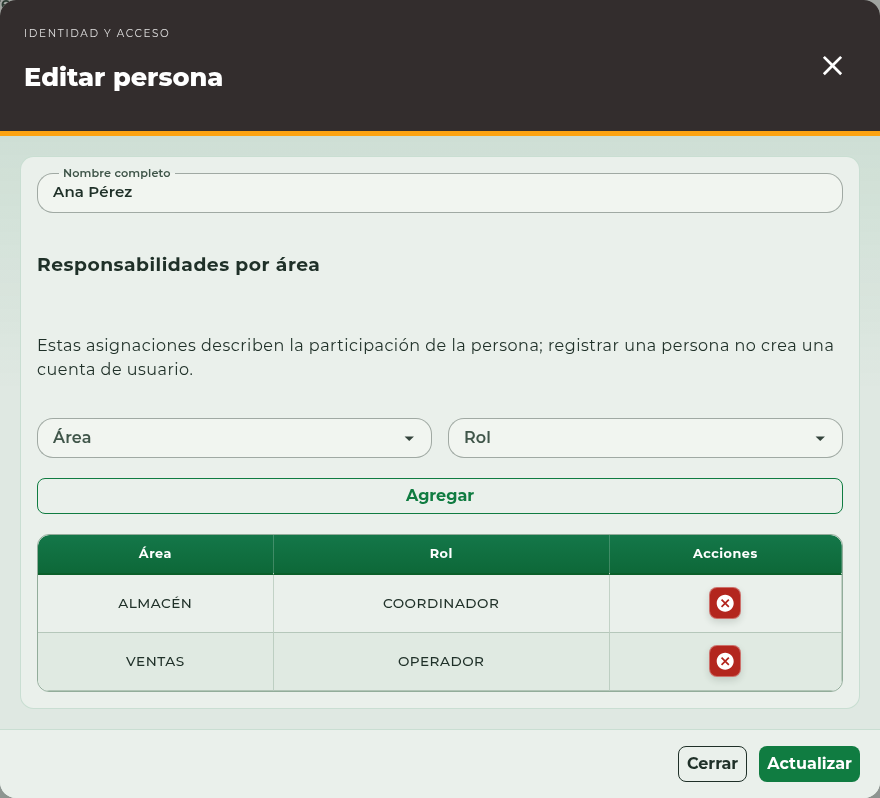

# 7. Personas

## Consultar personas

Abra **Identidad y acceso → Personas**. La **Tabla de Personas** muestra el nombre
y las responsabilidades de cada persona. Registrar una persona no crea una cuenta de ingreso.

<!-- manual:any persons:write -->
## Registrar una persona

**Antes de empezar.** Identifique el nombre completo y las áreas y roles que
corresponden a esa persona. Los catálogos deben estar disponibles.

1. Pulse **Nueva persona**.
2. En **Registrar persona**, capture **Nombre completo**.
3. Seleccione **Área** y **Rol**, y pulse **Agregar**.
4. Revise la asignación en la lista. Repita para otras áreas cuando corresponda.
5. Para corregir una asignación preparada, quítela y agregue la correcta.
6. Con al menos una asignación válida, pulse **Guardar**.
7. Compruebe el nombre y las responsabilidades en el listado.

Cada área puede aparecer una sola vez. **Agregar** prepara la asignación; **Guardar**
o **Actualizar** confirma todas las asignaciones.
<!-- manual:end -->

<!-- manual:any persons:write -->
## Editar responsabilidades

1. Busque la persona y pulse **Editar registro**.
2. Revise todas las asignaciones cargadas, no sólo la primera.
3. Cambie el nombre, quite una asignación con su control o agregue la que falta.
4. Mantenga al menos una responsabilidad válida y pulse **Actualizar**.
5. Compruebe que se conservaron las asignaciones que no debía retirar.

En edición están habilitados **Nombre completo**, la selección de **Área** y **Rol**,
y los controles para agregar o quitar responsabilidades. Para cambiar una asignación,
quite la anterior y agregue la correcta; no se edita una celda de la lista. Los cambios
se confirman juntos con **Actualizar**. Cambie las responsabilidades según la
organización real del trabajo.
<!-- manual:any users:manage -->
Los accesos de una cuenta se administran por separado en **Usuarios**.
<!-- manual:end -->
<!-- manual:end -->

## Filtrar la consulta

Utilice **Filtrar por área** y **Filtrar por rol**, seleccione sus opciones y
pulse **Buscar**. Si no aparece una persona, limpie los filtros y revise su nombre.

<!-- manual:any person:reports-read -->
## Exportar personas

Pulse **Exportar Excel**. Si aplicó un filtro por rol, quítelo o use **Limpiar filtros**;
ese filtro deshabilita la descarga. Puede filtrar por área.
<!-- manual:end -->

## Incidencias

<!-- manual:any persons:write -->
Si un área está repetida, corrija las asignaciones.
<!-- manual:end -->
Para otros mensajes, consulte [Errores y recuperación](15-errors-and-recovery.md).
