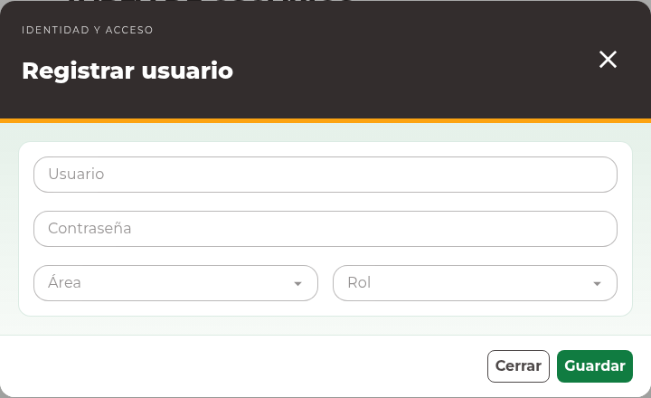
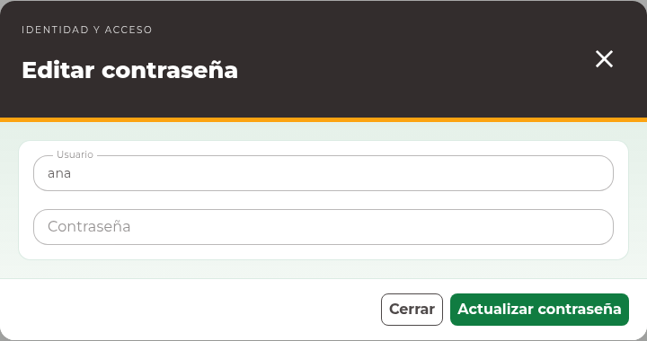

# 8. Usuarios

## Crear una cuenta

Abra **Identidad y acceso → Usuarios**. Esta función requiere permiso de
administración de usuarios. La **Tabla de Usuarios** permite distinguir el nombre
de acceso, la persona vinculada y la asignación organizativa.

1. Pulse **Nuevo usuario**.
2. En **Registrar usuario**, capture **Usuario** y **Contraseña**.
3. Seleccione **Área** y **Rol** según la responsabilidad autorizada.
4. Revise la captura y pulse **Guardar**.
5. Compruebe el registro en la tabla. Comunique el acceso por el medio autorizado
   en su organización, sin incluir la contraseña en observaciones ni reportes.

El nombre de usuario identifica la cuenta al ingresar. Use una contraseña que
cumpla los mensajes del formulario. No coloque una contraseña real en capturas de
pantalla ni en solicitudes de soporte.

## Editar una cuenta

**Antes de actualizar.** Cambiar el área o rol afecta lo que la cuenta puede ver y
hacer. Confirme la autorización de esa asignación y la identidad del usuario. No
asigne administración del sistema para resolver una consulta operativa.

1. Localice el usuario y pulse **Editar registro**.
2. Revise **Usuario**, **Área** y **Rol**.
3. Consulte **Persona vinculada**. Este campo conserva la vinculación existente;
   no permite reasignarla desde esta edición.
4. Cambie únicamente los campos autorizados y pulse **Actualizar**.
5. Compruebe los datos en el listado.

La edición de datos no muestra ni vuelve a enviar la contraseña. No necesita
conocer la contraseña anterior para corregir un nombre o asignación.

## Cambiar una contraseña

**Antes de actualizar una contraseña.** El cambio afecta el siguiente ingreso de
esa cuenta. Confirme quién debe recibir la nueva clave y el medio autorizado para
entregarla. No escriba la clave en observaciones ni en un reporte.

1. Identifique cuidadosamente la cuenta en la tabla.
2. Pulse **Cambiar contraseña**.
3. En **Editar contraseña**, compruebe el **Usuario** de consulta.
4. Escriba la nueva **Contraseña**.
5. Pulse **Actualizar contraseña** y espere la confirmación.

Si aparece un conflicto, cierre y actualice el listado antes de volver a preparar
el cambio para la cuenta vigente. Si se rechaza la autorización, solicite la
revisión de sus permisos; una cuenta de consulta no puede administrar otras cuentas.

## Consultar y reportar

Busque por nombre y pulse **Buscar**. Con permiso de reporte, **Exportar Excel**
descarga la consulta aplicada sin limitarse a la página visible. Las contraseñas
no forman parte de los datos de consulta de la tabla.
