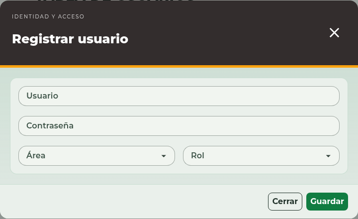
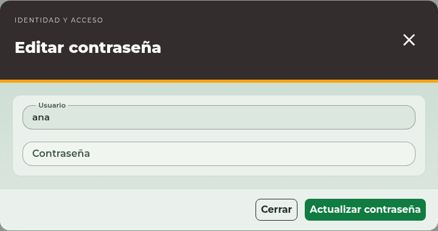

# 8. Usuarios

## Crear una cuenta

Abra **Identidad y acceso → Usuarios**. La tabla muestra cuenta, persona vinculada,
área y rol.

1. Pulse **Nuevo usuario**.
2. En **Registrar usuario**, capture **Usuario** y **Contraseña**.
3. Seleccione **Área** y **Rol** según la responsabilidad autorizada.
4. Revise la captura y pulse **Guardar**.
5. Compruebe el registro en la tabla. Comunique el acceso por el medio autorizado
   en su organización, sin incluir la contraseña en observaciones ni reportes.

La contraseña debe cumplir los mensajes del formulario. No la incluya en capturas
ni solicitudes de soporte.

## Editar una cuenta

**Antes de actualizar.** El área y rol determinan lo que la cuenta puede hacer.
Compruebe la identidad y la asignación autorizada.

1. Localice el usuario y pulse **Editar registro**.
2. Revise **Usuario**, **Área** y **Rol**.
3. Consulte **Persona vinculada**. Este campo conserva la vinculación existente;
   no permite reasignarla desde esta edición.
4. Modifique **Usuario**, **Área** o **Rol**, según la asignación autorizada, y pulse **Actualizar**.
5. Compruebe los datos en el listado.

En esta operación **Persona vinculada** es de consulta y no aparece un campo para
cambiar la contraseña. La contraseña actual se conserva; para sustituirla use la
acción independiente **Cambiar contraseña**.

## Cambiar una contraseña

**Antes de actualizar.** La nueva contraseña se usará en el siguiente ingreso.
Compruebe a quién debe entregarla y utilice el medio autorizado.

1. Identifique cuidadosamente la cuenta en la tabla.
2. Pulse **Cambiar contraseña**.
3. En **Editar contraseña**, compruebe el **Usuario** de consulta.
4. Escriba la nueva **Contraseña**.
5. Pulse **Actualizar contraseña** y espere la confirmación.

En este formulario sólo se captura **Contraseña**. **Usuario** es de consulta;
no se modifican área, rol ni persona vinculada.

Ante un conflicto o rechazo, siga [Errores y recuperación](15-errors-and-recovery.md).

## Consultar y reportar

Busque por nombre y pulse **Buscar**. La tabla no muestra contraseñas.

<!-- manual:any admin:reports-read -->
**Exportar Excel** descarga todos los resultados de la consulta.
<!-- manual:end -->
