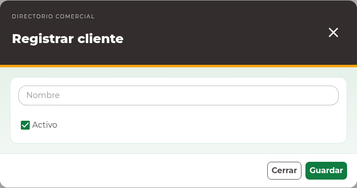

# 9. Clientes

## Consultar clientes

Abra **Directorio comercial → Clientes**. Utilice **Buscar por nombre** y
**Buscar** en la **Tabla de Clientes** para localizar el registro antes de crear
otro. Un cliente se utiliza, entre otros contextos, en el encabezado de una salida.

<!-- manual:any clients:create -->
## Registrar un cliente

1. Pulse **Nuevo cliente**.
2. En **Registrar cliente**, escriba **Nombre**.
3. Mantenga **Activo** marcado si debe ofrecerse en nuevas operaciones.
4. Pulse **Guardar** y espere la confirmación.
5. Compruebe el nombre y la disponibilidad en la tabla.

El formulario actual captura nombre y disponibilidad. No requiere teléfono.
No utilice el nombre para almacenar teléfonos, contraseñas u otros datos ajenos
a la identificación del cliente.
<!-- manual:end -->

<!-- manual:any clients:update -->
## Editar y desactivar

1. Localice la fila y pulse **Editar registro**.
2. Corrija **Nombre** o cambie **Activo**.
3. Pulse **Actualizar** y compruebe el resultado.

Desactivar un cliente evita su uso en las búsquedas operativas que requieren
clientes activos y conserva su relación con documentos existentes. No equivale
a eliminar las salidas de ese cliente.
<!-- manual:end -->

<!-- manual:any clients:create -->
## Registrar desde una salida

Si el selector de Cliente ofrece **Registrar cliente**, puede abrir el alta sin
abandonar la salida. Guarde el cliente y compruebe que queda seleccionado al
volver. Después complete y guarde la salida. Cerrar la salida no elimina el
cliente que ya se creó.
<!-- manual:end -->

<!-- manual:any client:reports-read -->
## Reporte y problemas frecuentes

**Exportar Excel** está disponible según los permisos. Aplique primero la búsqueda;
la exportación utiliza esa consulta y no sólo la página visible. Si no encuentra
un registro recién creado, limpie la búsqueda. Si el selector no lo ofrece,
compruebe su disponibilidad y que se haya guardado realmente.

Si se informa un conflicto de edición, utilice **Cerrar y actualizar listado** y
revise la versión actual antes de volver a corregir el nombre o disponibilidad.
<!-- manual:end -->
