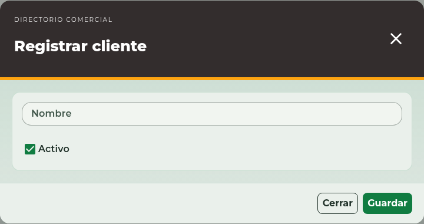

# 9. Clientes

<!-- manual:all clients:create clients:read -->
## Registrar un cliente desde el selector

Si falta el cliente de una salida, puede registrarlo desde **Cliente**, cuando su
cuenta tiene permiso. Primero debe **escribir el nombre del cliente nuevo dentro
del selector**; el nombre no tiene que existir previamente en el catálogo.

1. En el formulario de la salida, abra **Cliente** y escriba el nombre completo
   del cliente que desea registrar; por ejemplo, **Cliente nuevo**.
2. Espere a que termine la búsqueda. Si el cliente ya aparece, seleccione esa opción
   y continúe la salida.
3. Si falta, al final de la lista aparecerá **Registrar cliente «Cliente nuevo»**.
   Pulse ese botón. El texto entre comillas es el que escribió en el selector.
4. En el modal **Registrar cliente**, revise **Nombre**, precargado con ese texto,
   y corríjalo si es necesario. Mantenga **Activo** marcado para utilizarlo en la salida.
5. Pulse **Guardar** una sola vez y espere la confirmación.
6. Compruebe que vuelve a la salida con el cliente nuevo seleccionado.
7. Continúe la captura y confirme la salida cuando haya revisado sus datos y detalles.

**Si no aparece el botón:** compruebe que escribió un nombre, que la búsqueda
terminó sin error y que no hay una opción con ese mismo nombre. Con el selector
vacío, bloqueado o sin permiso de alta no aparece **Registrar cliente**.

**Cerrar** cancela el alta y conserva la salida en preparación. Si guarda el cliente,
su registro permanece aunque después cierre la salida.
<!-- manual:end -->

<!-- manual:any clients:page-view -->
## Consulta independiente

Abra **Directorio comercial → Clientes** y utilice
**Buscar por nombre** y **Buscar**. Use **Filtrar por columna** para limitar por
nombre o disponibilidad. La tabla permite comprobar ambos datos.
<!-- manual:end -->

<!-- manual:all clients:page-view clients:create -->
Para dar de alta desde esta página, pulse **Nuevo cliente**, complete los mismos
campos y guarde. Compruebe el cliente en el listado.
<!-- manual:end -->

<!-- manual:all clients:page-view clients:update -->
## Editar y desactivar

1. Localice el registro y pulse **Editar registro**.
2. Corrija **Nombre** o cambie **Activo**.
3. Pulse **Actualizar** y compruebe el resultado.

Los campos habilitados son **Nombre** y **Activo**. Se conserva el mismo cliente
y la relación con sus documentos; el formulario no modifica partidas de salidas.

Desactivar retira el cliente de nuevas operaciones y conserva sus salidas anteriores.
Ante un conflicto, siga [Errores y recuperación](15-errors-and-recovery.md).
<!-- manual:end -->

<!-- manual:all clients:page-view client:reports-read -->
## Exportar clientes

Aplique la búsqueda y pulse **Exportar Excel**. Consulte [Reportes](14-reports.md)
para revisar el alcance o recuperar una descarga.
<!-- manual:end -->
