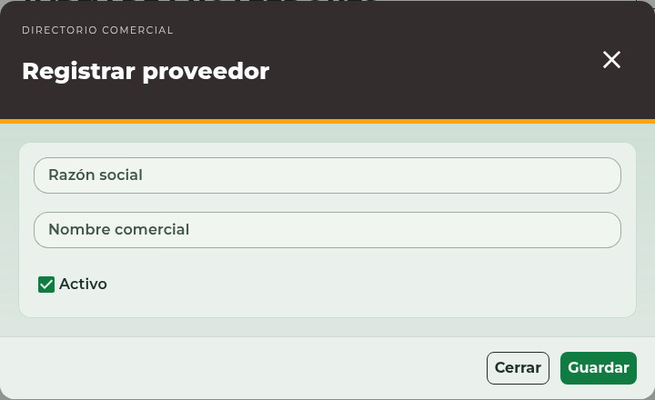

# 10. Proveedores

<!-- manual:all suppliers:manage suppliers:read -->
## Registrar un proveedor desde el selector

Si falta un proveedor, regístrelo al crear un material, consumible o compra. La acción
requiere permiso para registrar y consultar proveedores; no aparece en todos los selectores.

| Selector o formulario | Alta de proveedor |
| --- | --- |
| Nuevo material o consumible en Almacén | Disponible para una cuenta autorizada. |
| Nueva compra | Disponible para una cuenta autorizada. |
| Edición de un artículo o compra | No cambia ni crea proveedores; conserva el proveedor original. |
| Nueva merma | Utiliza el proveedor y material de origen existentes. |
| Filtros de Almacén, Compras o Movimientos | Sólo consulta y selecciona proveedores existentes. |
| Importar Excel | Sólo filtra proveedores existentes; no registra un proveedor desde el selector. |
| Salidas | Selecciona artículos con proveedor existente; no ofrece alta de proveedores. |

En Mermas, el proveedor debe tener un material de origen válido. Si falta, prepare
primero ese material y su proveedor; después registre la merma.

1. Abra **Proveedor** y **escriba el nombre comercial completo** que desea registrar;
   por ejemplo, **Proveedor nuevo**. Abrir el selector vacío no muestra el botón.
2. Espere a que termine la búsqueda. Si el proveedor ya aparece, selecciónelo.
   Si falta, pulse **Registrar proveedor «Proveedor nuevo»** al final de la lista,
   sin cerrar la captura principal. El nombre del botón corresponde al texto escrito.
3. En el modal **Registrar proveedor**, complete **Razón social** y revise el **Nombre comercial** precargado.
4. Mantenga **Activo** marcado si utilizará el proveedor en la operación.
5. Pulse **Guardar** y espere la confirmación.
6. Compruebe que vuelve al formulario principal y que el proveedor nuevo queda seleccionado.
7. Continúe y guarde el artículo o la compra cuando haya revisado la captura completa.

Si no aparece la acción, revise que haya texto escrito, que la búsqueda termine
sin error y que no exista una opción con el mismo nombre comercial. El botón
requiere un selector habilitado y los permisos de consulta y registro.

| Campo | Uso |
| --- | --- |
| Razón social | Identificación legal del proveedor. |
| Nombre comercial | Nombre visible en búsquedas y selectores. |
| Activo | Disponibilidad para nuevas operaciones que requieren proveedores activos. |

**Cerrar** cancela el alta y conserva la captura principal. Un proveedor guardado
permanece aunque después cierre esa captura.
<!-- manual:end -->

<!-- manual:any suppliers:page-view -->
## Consulta independiente

Abra **Directorio comercial → Proveedores**. Use
**Buscar por nombre** y **Buscar** para distinguir razón social y nombre comercial.
Use **Filtrar por columna** para buscar específicamente por nombre comercial,
razón social o, si está disponible para su cuenta, estado.
<!-- manual:end -->

<!-- manual:all suppliers:page-view suppliers:manage -->
Para registrar desde esta página, pulse **Nuevo proveedor**, complete los mismos
campos y guarde. Compruebe el proveedor en el listado.
<!-- manual:end -->

<!-- manual:all suppliers:page-view suppliers:update -->
## Editar y desactivar

1. Localice el proveedor y pulse **Editar registro**.
2. Cambie **Razón social**, **Nombre comercial** o **Activo**, según corresponda.
3. Pulse **Actualizar** y revise el resultado.

El código del proveedor se conserva; no se captura desde esta edición. Los cambios
no modifican existencias, costos ni partidas de compras o salidas.

Desactivar conserva el historial. Edite los datos de la misma empresa; no los
sustituya por los de otro proveedor. Ante un conflicto, siga
[Errores y recuperación](15-errors-and-recovery.md).
<!-- manual:end -->

<!-- manual:all suppliers:page-view supplier:reports-read -->
## Exportar proveedores

Revise la búsqueda y pulse **Exportar Excel**. Consulte [Reportes](14-reports.md)
para revisar el alcance o recuperar una descarga.
<!-- manual:end -->
