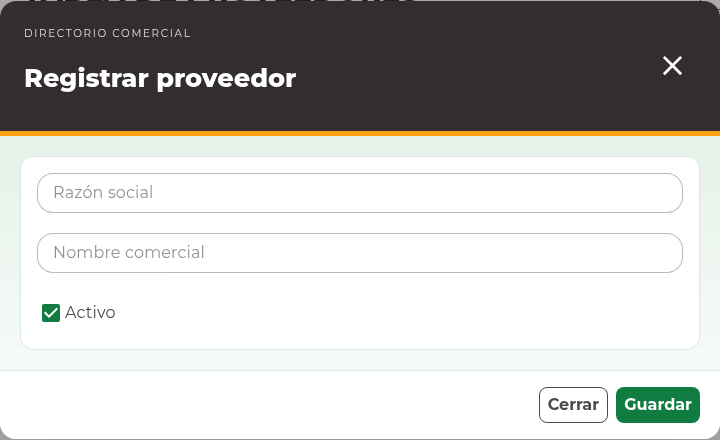

# 10. Proveedores

<!-- manual:all suppliers:manage suppliers:read -->
## Registrar un proveedor desde el selector

Puede iniciar esta alta desde el selector **Proveedor** de un material, consumible
o compra que esté preparando. Primero busque para evitar repetir un registro.

1. Abra **Proveedor** y busque su nombre comercial. Si ya existe, selecciónelo.
2. Si falta y aparece **Registrar proveedor**, pulse esa acción sin cerrar la captura principal.
3. En el modal **Registrar proveedor**, complete **Razón social** y revise el **Nombre comercial** precargado.
4. Mantenga **Activo** marcado si utilizará el proveedor en la operación.
5. Pulse **Guardar** y espere la confirmación.
6. Compruebe que vuelve al formulario principal y que el proveedor nuevo queda seleccionado.
7. Continúe y guarde el artículo o la compra cuando haya revisado la captura completa.

| Campo | Uso |
| --- | --- |
| Razón social | Identificación legal del proveedor. |
| Nombre comercial | Nombre visible en búsquedas y selectores. |
| Activo | Disponibilidad para nuevas operaciones que requieren proveedores activos. |

No se captura teléfono. **Cerrar** abandona el alta secundaria sin crear un registro.
Si el servicio rechaza el alta, revise el aviso y corrija los campos; la captura de
origen se conserva. El proveedor confirmado queda guardado independientemente del
artículo o compra: cerrar después ese formulario no elimina el proveedor.
<!-- manual:end -->

<!-- manual:any suppliers:page-view -->
## Consulta independiente

Con acceso de administración, abra **Directorio comercial → Proveedores**. Use
**Buscar por nombre** y **Buscar** para distinguir razón social y nombre comercial.
<!-- manual:end -->

<!-- manual:all suppliers:page-view suppliers:manage -->
Para registrar desde esta página, pulse **Nuevo proveedor**, complete los mismos
campos y guarde. Se actualiza el listado; no hay otro formulario de origen pendiente.
<!-- manual:end -->

<!-- manual:all suppliers:page-view suppliers:update -->
## Editar y desactivar

1. Localice el proveedor y pulse **Editar registro**.
2. Compruebe la identidad de la empresa, corrija los campos o desmarque **Activo**.
3. Pulse **Actualizar** y revise el resultado.

Desactivar conserva el historial. La edición no sustituye por otra empresa al
proveedor de compras o artículos existentes. Ante un conflicto, cierre y actualice
el listado antes de volver a preparar los cambios.
<!-- manual:end -->

<!-- manual:all suppliers:page-view supplier:reports-read -->
## Exportar proveedores

Revise la búsqueda aplicada y pulse **Exportar Excel**. El archivo incluye la
consulta completa, no sólo la página visible. El [capítulo de reportes](14-reports.md)
explica su alcance y la recuperación de descargas.
<!-- manual:end -->
