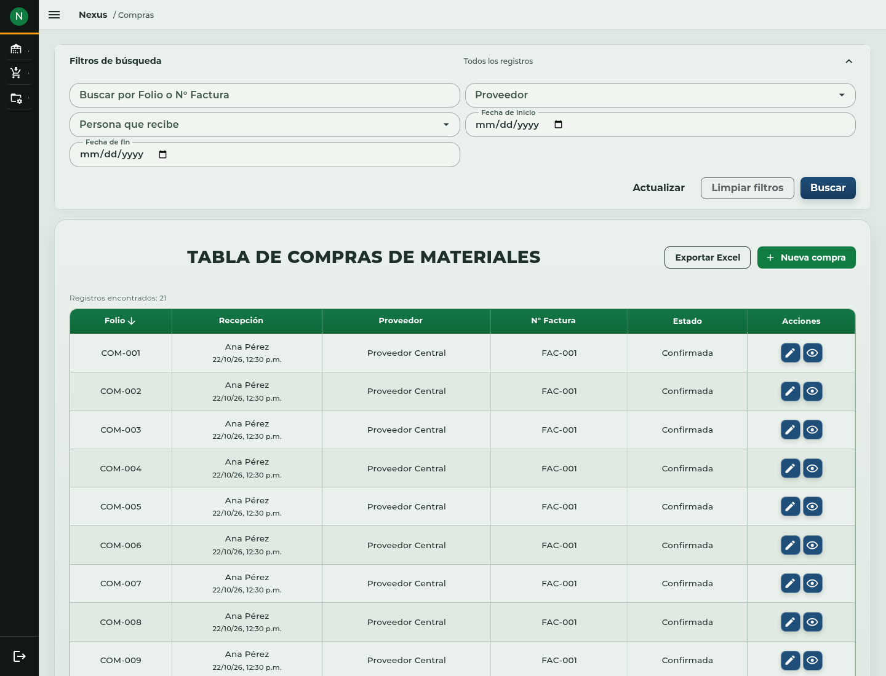
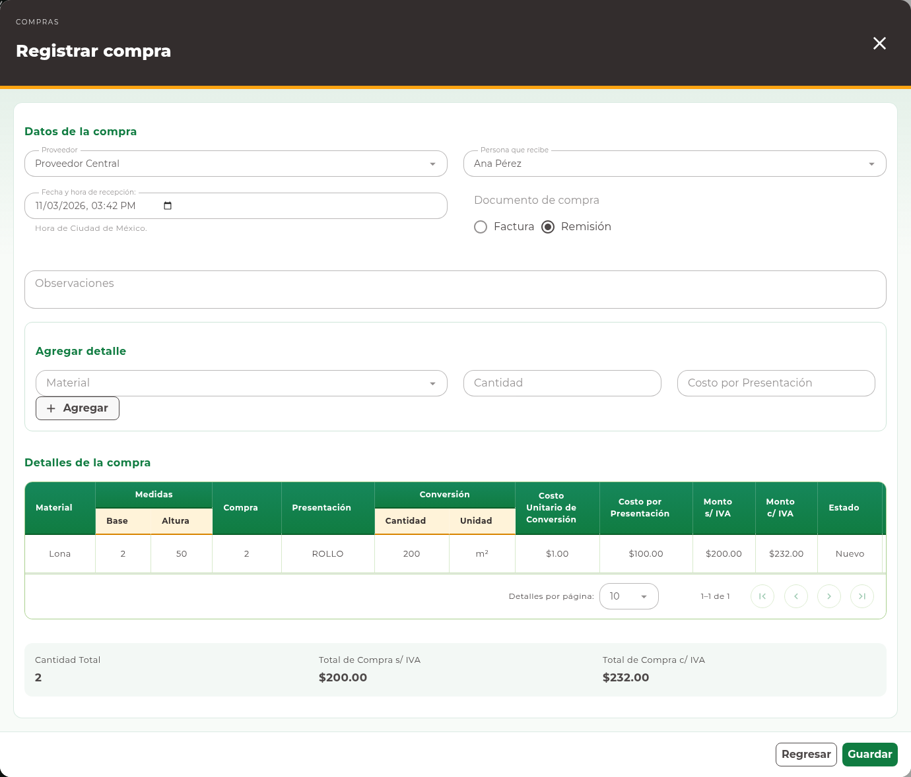
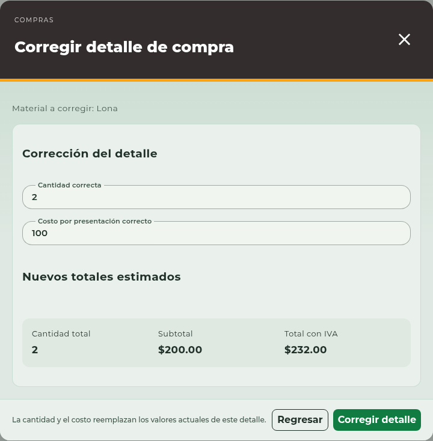
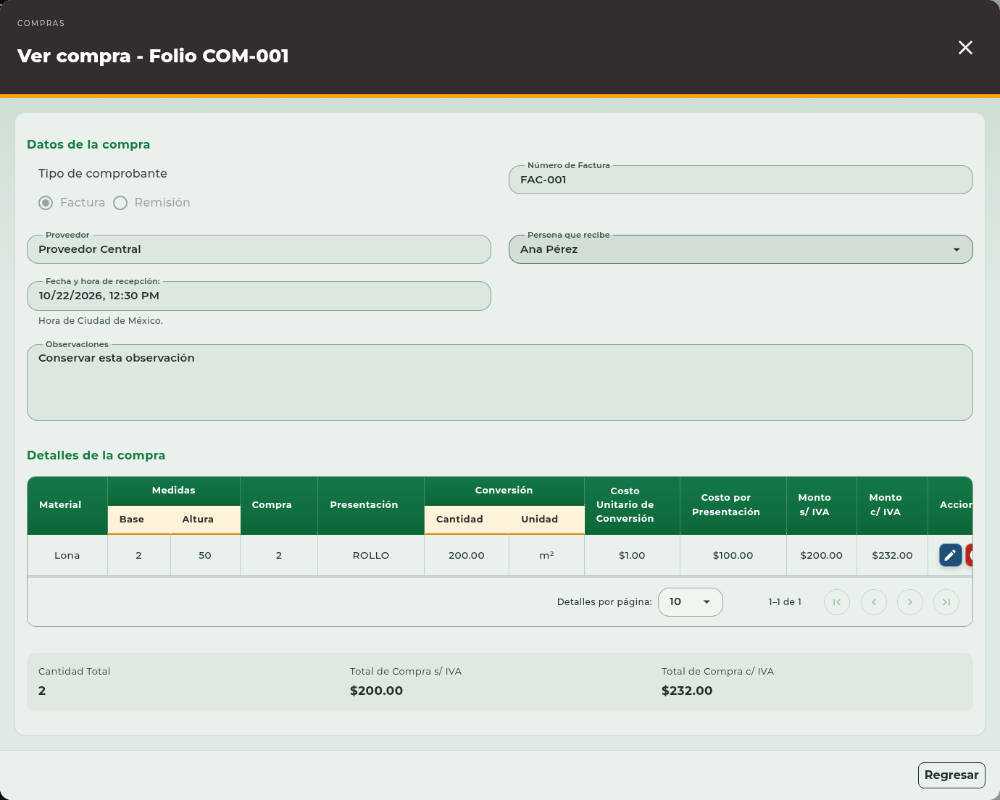

# 11. Compras

<!-- module:any reference -->

Abra **Compras → Materiales** o **Consumibles**. Busque por folio, factura,
proveedor, persona o fecha y pulse **Buscar**.

<!-- module:end -->

<!-- module:any compras-materiales -->

Abra **Compras → Materiales**. Busque por folio, factura, proveedor, persona o fecha y pulse **Buscar**.

<!-- module:end -->

<!-- module:any compras-consumibles -->

Abra **Compras → Consumibles**. Busque por folio, factura, proveedor, persona o fecha y pulse **Buscar**.

<!-- module:end -->

<!-- module:any reference compras-materiales -->

<!-- module:end -->

<!-- manual:any goods:receipts-manage -->
## Registrar una compra

1. Pulse **Nueva compra**. Seleccione primero el proveedor para habilitar los detalles y después la persona que recibe.
2. Elija **Factura** o **Remisión**, capture el número cuando corresponda y revise la fecha.
3. En el último renglón de la tabla, seleccione el artículo bajo **Material**, capture **Cantidad** y **Costo por presentación** en sus columnas y pulse **Agregar**.
4. Repita para las demás partidas y revise cantidades e importes estimados.
5. Pulse **Guardar** y compruebe el folio y la existencia recibida.

El nombre, las medidas, la presentación y la unidad de los artículos se muestran desde el catálogo de Materiales. Los importes conservan los valores de la compra.

La tabla coloca **Presentación** antes de **Compra**; el costo capturado y su alcance preceden a **Conversión** e **Importes**. **Conversión** reúne cantidad, unidad y costo unitario; **Importes**, montos sin IVA y con IVA.

Todos los detalles pertenecen al **Proveedor** del encabezado; no se repite en el nombre de cada artículo. En móvil la captura se apila y conserva los mismos valores.

<!-- module:any reference compras-materiales -->

<!-- module:end -->

Capture el costo por presentación; el servidor calcula los importes definitivos.
Las compras no actualizan el costo máximo del inventario: se configura en **Almacén**.

<!-- manual:all suppliers:manage suppliers:read -->
### Registrar un proveedor durante la compra

En **Proveedor**, escriba el **nombre comercial completo** del proveedor nuevo y
espere a que termine la búsqueda. Si ya existe, selecciónelo. Si falta, pulse
**Registrar proveedor «texto escrito»** al final de la lista. Con el campo vacío
no aparece el botón. Complete **Razón social**, revise **Nombre comercial** y
**Activo**, guarde y compruebe que el proveedor queda seleccionado en la compra.
<!-- manual:end -->

<!-- manual:all materials:read materials:write presentations:read unit:measures-read -->
### Registrar un artículo durante la compra

Seleccione primero el proveedor de la compra. El selector de artículos consulta el catálogo completo de Materiales o Consumibles, incluidos los que aún no están vinculados con ese proveedor. Busque y agregue sólo los artículos comprados; al guardar, Nexus crea los vínculos faltantes y recibe sus cantidades.

<!-- module:any reference compras-materiales -->

En **Material**, **escriba el nombre completo** del artículo que falta, espere la
búsqueda y revise las opciones. Si necesita el alta, pulse
**Registrar material «texto escrito»** al final de la lista. Con el selector vacío
no aparece el botón.

<!-- module:end -->

<!-- module:any reference compras-consumibles -->

En **Consumible**, **escriba el nombre completo** del artículo que falta, espere
la búsqueda y revise las opciones. Si necesita el alta, pulse
**Registrar consumible «texto escrito»** al final de la lista. Con el selector vacío
no aparece el botón.

<!-- module:end -->

Complete el formulario auxiliar y guarde. En consumibles, revise la sección de medidas: seleccionar la presentación KILOGRAMOS o METRO LINEAL fija ambas medidas en 1 × 1 y oculta esos campos durante el alta. Después de pulsar **Agregar**, la tabla de detalles muestra medidas, unidad y cantidad convertida. El artículo nuevo queda seleccionado;
todavía debe capturar **Cantidad** y **Costo por presentación**,
pulsar **Agregar** y guardar la compra. El alta auxiliar guarda sólo la identidad del catálogo: no crea vínculo con el proveedor ni existencia. Si cancela la compra, el artículo queda disponible en el catálogo. La asociación y la existencia se registran al guardar la compra.
<!-- manual:end -->

## Editar o corregir

- **Editar compra:** cambie **Factura/Remisión**, el número de factura cuando corresponda, **Persona que recibe**, **Fecha y hora de recepción** u **Observaciones**; pulse **Actualizar**.
- **Agregar detalles:** prepare las nuevas partidas y confirme; compruebe la existencia recibida.
- **Corregir detalle:** capture **Cantidad correcta** y **Costo por presentación correcto** y confirme **Corregir detalle**.
- **Cancelar detalle:** compruebe la partida y confirme la reversión de su existencia.

| Operación | Campos habilitados | Datos de consulta o conservados |
| --- | --- | --- |
| Editar una compra no cancelada | Tipo de comprobante, factura cuando aplica, receptor, fecha/hora y observaciones; puede agregar nuevas partidas. | Proveedor, folio y partidas ya registradas. Los importes se calculan. |
| Corregir detalle activo | Cantidad correcta y Costo por presentación correcto. | Artículo, proveedor, presentación y medidas. La cantidad corregida no puede superar la vigente. |
| Cancelar detalle | Confirmación de la partida seleccionada, sin capturar otros datos. | Resto del encabezado y partidas; compruebe que la existencia permita la reversión. |
| Consultar compra cancelada | Ninguno. | Encabezado, partidas y totales históricos; no se agregan ni corrigen detalles. |

Las partidas nuevas se preparan con artículo, cantidad y costo por presentación.
Puede retirar una partida nueva antes de guardar. Las partidas ya registradas se
atienden con **Corregir detalle** o **Cancelar detalle**, no sobrescribiendo la fila.
Al elegir Remisión, no se captura número de factura. Los selectores requieren los
permisos de consulta correspondientes.

<!-- module:any reference compras-materiales -->

<!-- module:end -->

La corrección recalcula la compra con sus partidas activas. Cambiar sólo el costo
conserva la existencia; reducir la cantidad ajusta la diferencia. La cantidad
correcta no puede superar la registrada. Tras corregir o cancelar una partida,
la compra se muestra actualizada.

Si la compra ya se utilizó, su reversión puede rechazarse. Cancelar la confirmación
no modifica datos.
<!-- manual:end -->

## Consultar una compra

**Ver compra** muestra encabezado, partidas y totales. Use **Regresar** para cerrar.

| Situación | Qué muestra la compra |
| --- | --- |
| Confirmada | Tiene partidas activas. |
| Partidas activas y canceladas | Sólo las activas integran los totales. |
| Cancelada | Totales históricos. Sólo consulta. |

Las partidas canceladas se conservan sin botones de acción.

<!-- module:any reference compras-materiales -->

<!-- module:end -->

<!-- module:any reference compras-materiales -->

<!-- module:end -->

<!-- module:any reference compras-consumibles -->

<!-- module:end -->

Los totales de una compra cancelada conservan el saldo que había inmediatamente
antes de cancelar su última partida, sin sumar de nuevo las partidas canceladas antes.
No representan existencia vigente
ni se suman en los reportes de compras activas.

<!-- manual:any warehouse:reports-read -->
## Exportar compras

Pulse **Exportar Excel**, seleccione el alcance y confirme **Descargar Excel**.
Consulte [Reportes](14-reports.md) para elegir periodo o filtros.
<!-- manual:end -->

Sin la opción de costo total, el importe sin IVA es Cantidad comprada × Costo por presentación. Las medidas representan la conversión de la unidad.

### Capturar el costo total del detalle

El campo y la columna se llaman **Costo por presentación**; capture siempre el importe sin IVA.
Marque **Usar el costo por presentación como costo total** cuando el importe ingresado
cubra toda la cantidad de esa partida, para cualquier presentación.
Por ejemplo, cantidad 10 y costo total sin IVA $500 dan costo unitario $50,
subtotal $500 y total con IVA $580. Las medidas no alteran este reparto del costo.
Sin marcar, el costo se interpreta por presentación y el subtotal es cantidad × costo.
La tabla y el Excel identifican el alcance del costo. La corrección conserva el modo
registrado; su campo de costo muestra si corresponde al total o por presentación.

Con presentación **KILOGRAMOS** o **METRO LINEAL**, las medidas son `1 × 1` y no se capturan. Puede comprar fracciones, por ejemplo `0.75`; el stock aumenta en esa misma cantidad. En KILOGRAMOS y METRO LINEAL con medidas `1 × 1`, la opción de costo total se activa automáticamente y no puede desmarcarse. En otras presentaciones se elige manualmente. Por ejemplo, `0.75 kg` con costo total de `$150` produce costo unitario de `$200`, subtotal de `$150` y total con IVA de `$174`.
