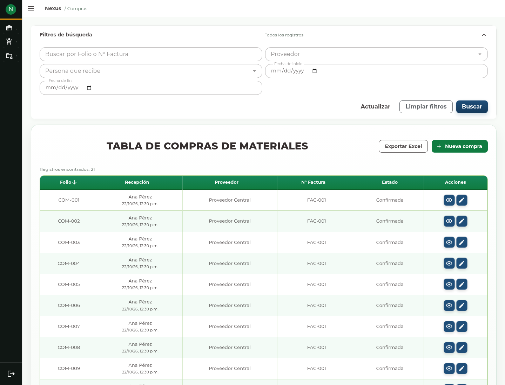
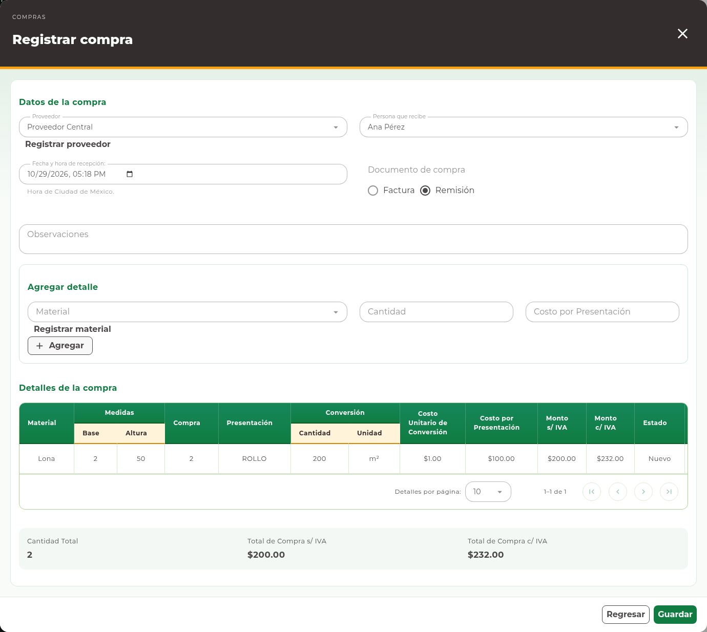
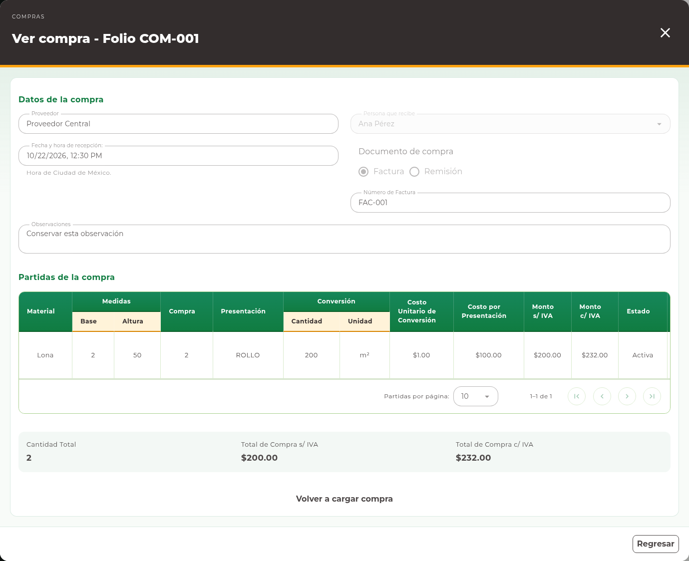
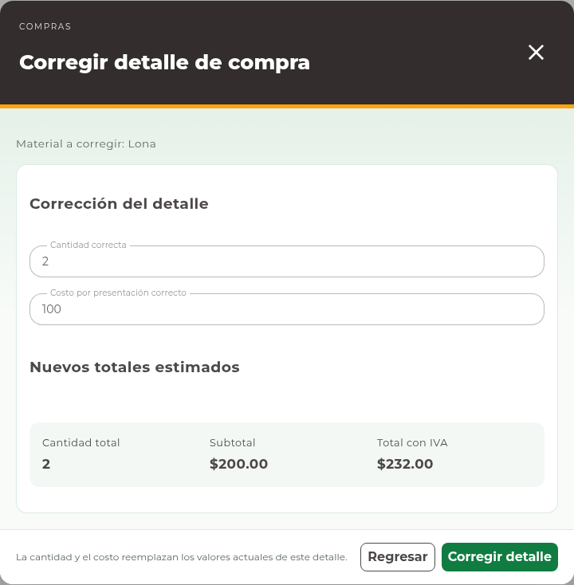

# 11. Compras

## Consultar recepciones

Abra **Compras → Materiales** o **Compras → Consumibles**. Cada contexto tiene
su tabla. Busque por folio o número de factura y aplique proveedor, persona que
recibe y fechas cuando los necesite. Pulse **Buscar** para utilizar esos filtros.

<!-- manual:any goods:receipts-manage -->
## Registrar una compra

**Antes de empezar.** Identifique el proveedor, la persona que recibe, el documento
de compra y los artículos recibidos. Revise las unidades y costos por presentación.

**Qué va a conseguir.** Registrar la mercancía recibida y sus importes en un
documento. Al guardarlo se afectan las existencias. Tenga el documento físico a la
vista y no registre el mismo recibo dos veces.

1. Pulse **Nueva compra** para abrir **Registrar compra**.
2. Seleccione **Proveedor** y **Persona que recibe**.
3. Revise **Fecha y hora de recepción:**.
4. Seleccione **Factura** o **Remisión**. Capture **Número de Factura** cuando
   la compra sea facturada y complete **Observaciones** si corresponde.
5. Seleccione el **Material** o **Consumible** del proveedor elegido.
6. Capture **Cantidad** y **Costo por Presentación**; pulse **Agregar**.
7. Revise la partida, sus conversiones y los **Totales de compra**. Repita para
   las demás partidas. Para retirar una partida todavía no guardada, utilice
   **Quitar detalle nuevo**.
8. Compruebe todas las partidas y pulse **Guardar** en el formulario principal.
9. Espere la confirmación y localice el folio de la compra en el listado.

**Agregar** no registra una recepción: prepara una partida local. **Guardar**
confirma el documento y sus efectos. Las conversiones e importes mostrados durante
la captura son una vista previa; compruebe los valores de la compra guardada.
No escriba el importe total en el campo de costo por presentación.

Si falta un proveedor o artículo y aparece su acción **Registrar**, utilice el
alta secundaria. El artículo creado desde la compra no necesita repetir la
entrada inicial: las existencias se reciben al guardar la compra.
<!-- manual:end -->

## Consultar una compra

**Ver compra** abre el documento para consultar folio, proveedor, persona que
recibe, fecha, factura, observaciones y partidas. Con permiso de gestión también
ofrece las acciones de corrección y cancelación de partidas. Use **Regresar** al terminar.

<!-- manual:any goods:receipts-manage -->
## Editar el encabezado

Para una modificación autorizada:

1. Pulse **Editar compra** en el folio correcto.
2. Compruebe el proveedor, que se muestra de consulta.
3. Modifique los campos habilitados del encabezado, incluidas **Observaciones**.
4. Pulse **Actualizar** y consulte nuevamente el documento.

Las observaciones del encabezado pueden editarse. Los datos y observaciones
conservados en el historial de movimientos pertenecen a sus operaciones; no son
el mismo dato que el encabezado de la compra.
<!-- manual:end -->

<!-- manual:any goods:receipts-manage -->
## Agregar partidas a una compra existente

1. Abra **Editar compra** en el folio al que corresponde la recepción adicional.
2. Compruebe el proveedor, que permanece bloqueado.
3. Seleccione el artículo de ese proveedor, capture **Cantidad** y **Costo por
   Presentación** y pulse **Agregar**.
4. Revise las partidas nuevas y los totales. Use **Quitar detalle nuevo** si preparó una partida equivocada.
5. Pulse **Actualizar**, espere la confirmación y vuelva a consultar la compra.

Las partidas nuevas incrementan existencias al confirmar. Las ya registradas no
vuelven a recibirse y se conservan sin sobrescribirlas. Para cambiar una partida
persistida, utilice su corrección o cancelación específica.

## Corregir una partida registrada

**Antes de confirmar.** Corregir sustituye la cantidad y el costo de una partida
ya guardada y puede modificar inventario e importes. Capture los valores finales
correctos; no escriba solamente la diferencia.

1. Abra **Ver compra** y localice la partida.
2. Pulse **Corregir detalle**.
3. Revise el artículo y capture **Cantidad correcta** y **Costo por presentación
   correcto**.
4. Compruebe **Nuevos totales estimados**.
5. Pulse **Corregir detalle**, revise la confirmación y confirme sólo si los
   datos son correctos. Puede usar **Cancelar** para no aplicar la corrección.
6. Compruebe la partida, los importes y las existencias resultantes.

La cantidad correcta representa el valor final de la partida, no una diferencia.
No puede superar la cantidad recibida vigente. Puede conservar la cantidad si sólo
cambia el costo; esa corrección no genera un cambio de existencia. Reducir la
cantidad requiere saldo suficiente para revertir la diferencia.
El sistema puede rechazar una corrección incompatible con las existencias actuales.
No compense ese rechazo modificando un artículo distinto.

## Cancelar una partida

**Antes de cancelar.** Compruebe que debe anular esa partida, no otra del mismo
artículo. La cancelación modifica sus efectos y conserva el historial. Si tiene
dudas sobre una recepción ya utilizada, consulte al responsable de Almacén.

En **Ver compra**, **Cancelar detalle** solicita una confirmación. Revise folio,
artículo y consecuencia antes de confirmar **Cancelar detalle**. **Cancelar**
abandona la confirmación sin aplicar el cambio. Compruebe el estado de la partida
y los totales actualizados después de una cancelación exitosa.

La cancelación conserva el rastro de la operación y puede ser rechazada si el
estado o saldo no la permiten. Consulte [Movimientos](13-movements.md) para
contrastar los efectos y [Reportes](14-reports.md) para exportar por consulta o mes.
Ante una respuesta incierta, consulte el folio antes de volver a registrar la compra.

Cancelar la última partida activa deja la compra **Cancelada**. El documento y su
historial se conservan para consulta; no se elimina la compra ni se habilita otra recepción sobre ella.
<!-- manual:end -->

<!-- manual:any warehouse:reports-read -->
## Exportar compras

En el listado, pulse **Exportar Excel** y seleccione filtros aplicados o periodo
mensual. Compruebe el contexto Materiales/Consumibles y el alcance elegido. El
[capítulo de reportes](14-reports.md) explica los pasos y la recuperación de una descarga fallida.
<!-- manual:end -->
