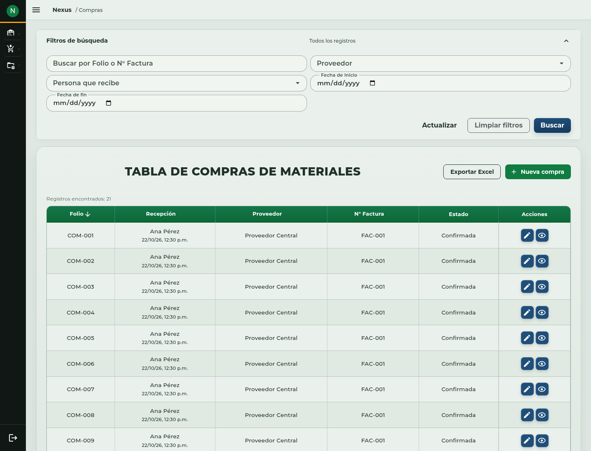
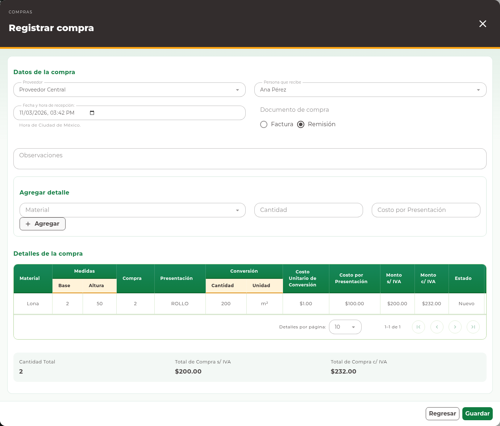
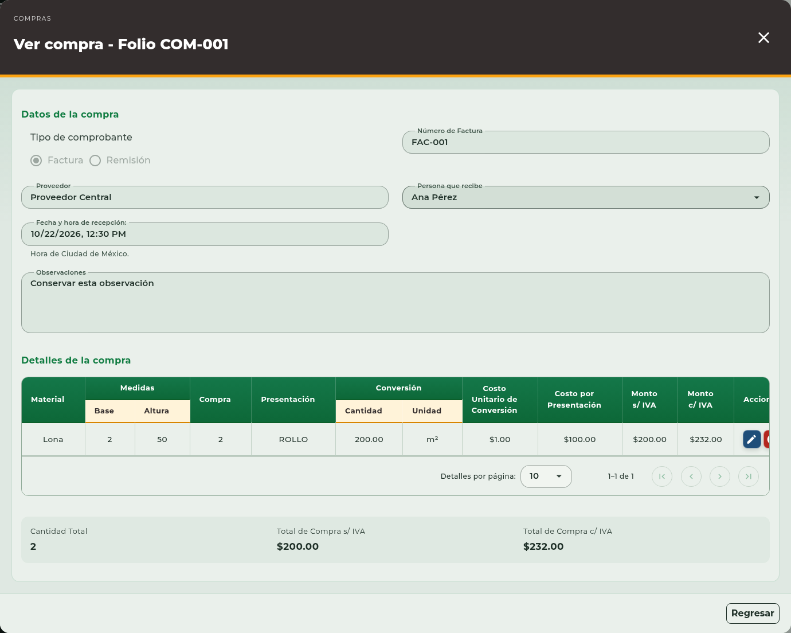
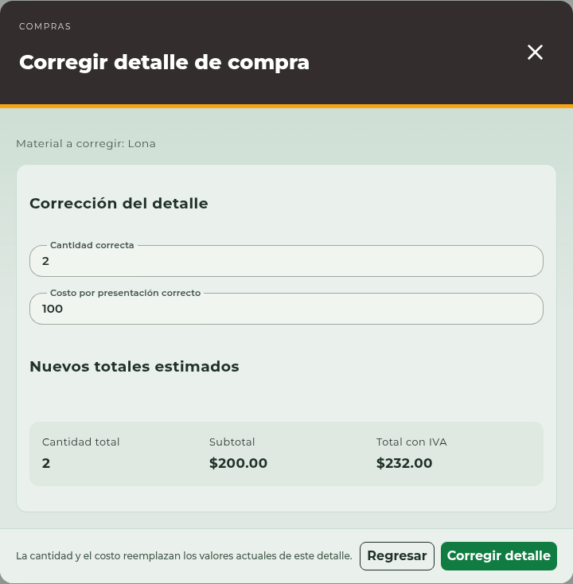

# 11. Compras

## Consultar recepciones

Abra **Compras → Materiales** o **Compras → Consumibles**. Cada contexto tiene
su tabla. Busque por folio o número de factura y aplique proveedor, persona que
recibe y fechas cuando los necesite. Pulse **Buscar** para utilizar esos filtros.

<!-- manual:any goods:receipts-manage -->
## Registrar una compra

**Antes de empezar.** Reúna comprobante, proveedor, persona que recibe y artículos.
Guardar la compra incrementa existencias; compruebe que la recepción no esté registrada.

1. Pulse **Nueva compra** para abrir **Registrar compra**.
2. Seleccione **Factura** o **Remisión**. Capture **Número de Factura** cuando
   la compra sea facturada.
3. Seleccione **Proveedor** y **Persona que recibe**.
4. Revise **Fecha y hora de recepción:** y complete **Observaciones** si corresponde.
5. Seleccione el **Material** o **Consumible** del proveedor elegido.
6. Capture **Cantidad** y **Costo por Presentación**, compruebe **Presentación**
   y pulse **Agregar**.
7. Revise el detalle, sus conversiones y los **Totales de compra**. Repita para
   los demás detalles. Para retirar un detalle todavía no guardado, utilice
   **Quitar detalle nuevo**.
8. Compruebe todos los detalles y pulse **Guardar** en el formulario principal.
9. Espere la confirmación y localice el folio de la compra en el listado.

**Cantidad** admite valores desde 1 y **Costo por Presentación** debe ser positivo.
Cambiar de proveedor borra detalles preparados y Persona que recibe: vuelva a revisarlos.
Las fechas y horas usan el horario de Ciudad de México.

Los importes mostrados son estimados hasta guardar. Capture el costo por presentación,
no el total de la compra.

<!-- manual:any suppliers:manage materials:write -->
Si falta un proveedor o artículo, escriba su nombre en el selector y pulse
**Registrar «nombre»** dentro del desplegable. Complete el formulario y guarde;
el registro nuevo quedará seleccionado. La recepción se registra al guardar la compra.
<!-- manual:end -->
<!-- manual:end -->

## Consultar una compra

**Ver compra** muestra folio, proveedor, persona que recibe, fecha, factura,
observaciones y detalles. Use **Regresar** al terminar. Las opciones de carga y
recuperación se explican en [Consultas de documentos](02-navigation-and-controls.md#consultas-de-documentos).

<!-- manual:any goods:receipts-manage -->
## Editar el encabezado

Para una modificación autorizada:

1. Pulse **Editar compra** en el folio correcto.
2. Compruebe el proveedor, que se muestra de consulta.
3. Modifique los campos habilitados del encabezado, incluidas **Observaciones**.
4. Pulse **Actualizar** y consulte nuevamente el documento.

Editar **Observaciones** del encabezado conserva las observaciones de los movimientos anteriores.
<!-- manual:end -->

<!-- manual:any goods:receipts-manage -->
## Agregar detalles a una compra existente

1. Abra **Editar compra** en el folio al que corresponde la recepción adicional.
2. Compruebe el proveedor, que permanece bloqueado.
3. Seleccione el artículo de ese proveedor, capture **Cantidad** y **Costo por
   Presentación** y pulse **Agregar**.
4. Revise los detalles nuevos y los totales. Use **Quitar detalle nuevo** si preparó un detalle equivocado.
5. Pulse **Actualizar**, espere la confirmación y vuelva a consultar la compra.

Al confirmar se reciben sólo los detalles nuevos. Para cambiar uno ya guardado,
use su corrección o cancelación.

## Corregir un detalle registrado

**Antes de confirmar.** La corrección cambia inventario e importes. Capture los
valores finales de cantidad y costo, no la diferencia.

1. Abra **Ver compra** y localice el detalle.
2. Pulse **Corregir detalle**.
3. Revise el artículo y capture **Cantidad correcta** y **Costo por presentación
   correcto**.
4. Compruebe **Nuevos totales estimados**.
5. Pulse **Corregir detalle**, revise la confirmación y confirme sólo si los
   datos son correctos. Puede usar **Cancelar** para no aplicar la corrección.
6. Compruebe el detalle, los importes y las existencias resultantes.

| Corrección | Regla |
| --- | --- |
| Cantidad correcta | Mayor que cero, incluso una fracción menor que 1; no puede superar la cantidad recibida vigente. |
| Sólo costo | Puede conservar la cantidad; no cambia la existencia. |
| Reducir cantidad | Requiere stock suficiente para revertir la diferencia. |

Si la existencia impide corregir, revise el caso; no compense cambiando otro artículo.

## Cancelar un detalle

**Antes de cancelar.** Compruebe el detalle y su proveedor. Cancelar revierte su
efecto en inventario; una recepción ya utilizada puede requerir revisión de Almacén.

En **Ver compra**, **Cancelar detalle** solicita una confirmación. Revise folio,
artículo y consecuencia antes de confirmar **Cancelar detalle**. **Cancelar**
abandona la confirmación sin aplicar el cambio. Compruebe el estado del detalle
y los totales actualizados después de una cancelación exitosa.

El estado o saldo pueden impedir cancelar. Revise los efectos en [Movimientos](13-movements.md).
Ante un envío sin respuesta, consulte [Errores y recuperación](15-errors-and-recovery.md).

Al cancelar el último detalle activo, la compra queda **Cancelada** y conserva su
historial. No admite nuevas recepciones.
<!-- manual:end -->

<!-- manual:any warehouse:reports-read -->
## Exportar compras

Pulse **Exportar Excel** y compruebe el contexto Materiales/Consumibles.
[Reportes](14-reports.md) explica los filtros y periodos disponibles.
<!-- manual:end -->
