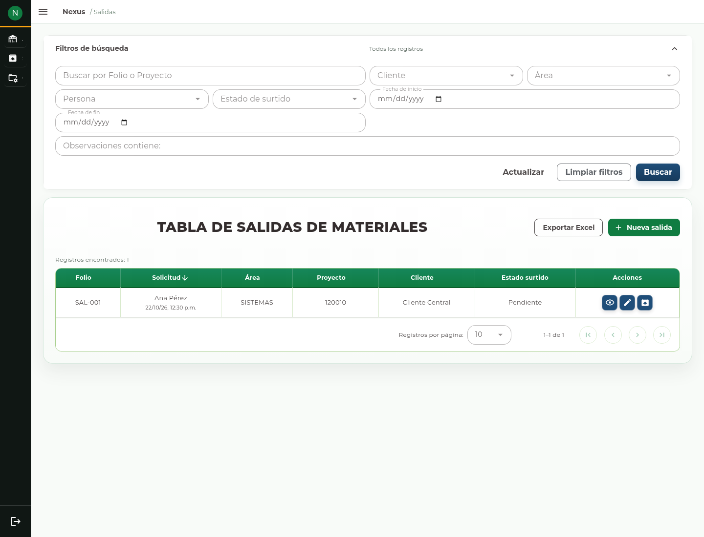
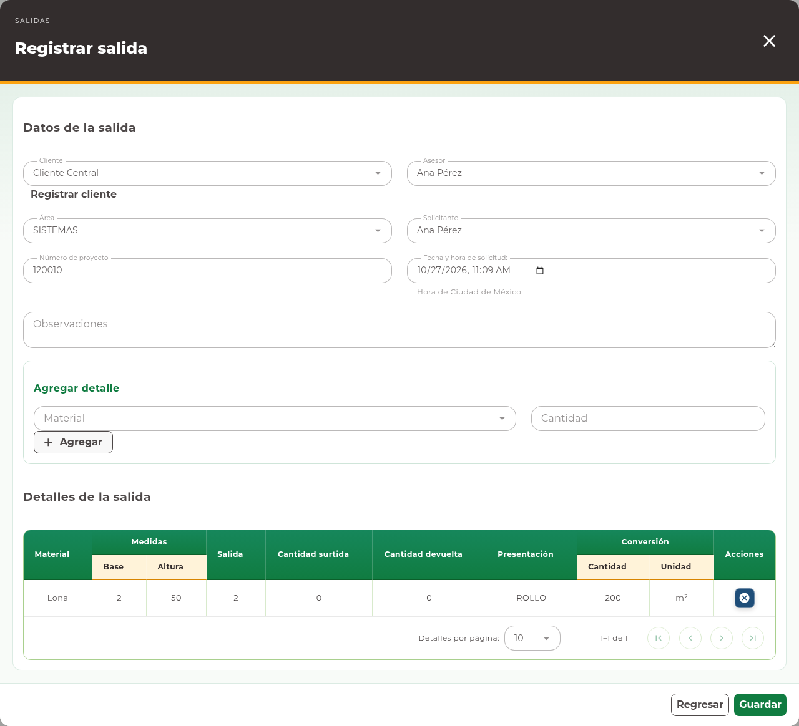
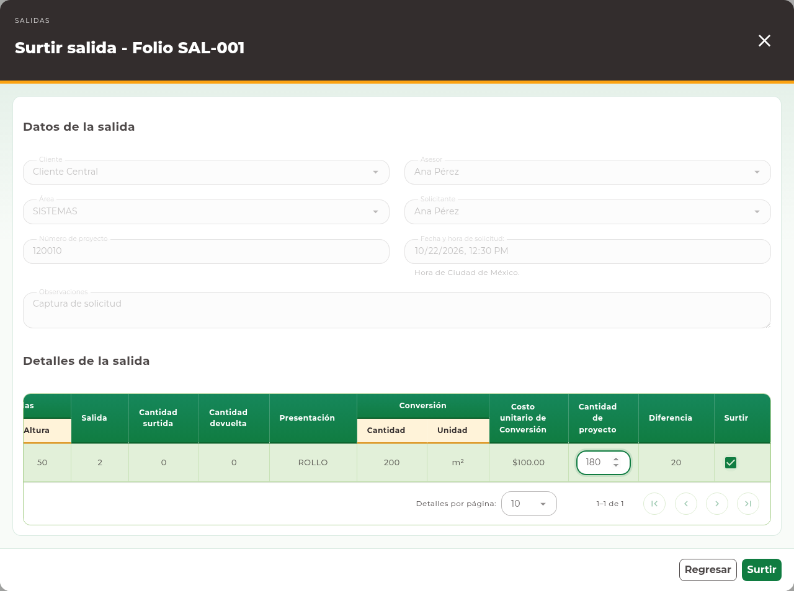
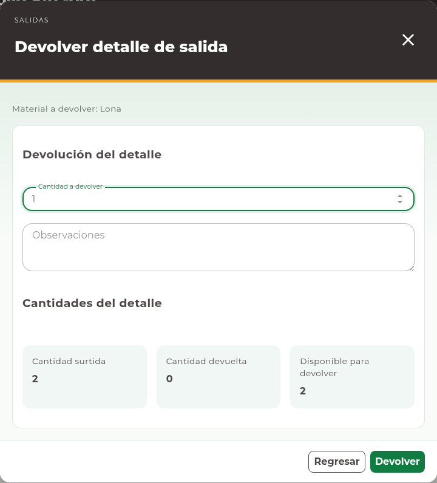

# 12. Salidas

## Elegir el contexto y consultar

Abra **Salidas → Materiales**, **Consumibles** o **Mermas**. Busque por folio o
proyecto y utilice los filtros disponibles de encabezado, fechas y **Observaciones
contiene:**. Pulse **Buscar**. Cada tabla reúne las solicitudes de su contexto;
no mezcle una salida de material con una salida de merma del mismo nombre.

Con acceso de Auxiliar o Coordinador de Almacén puede consultar y registrar salidas
para todas las áreas. Si pertenece a un área operativa, sólo verá sus áreas
autorizadas y sólo podrá registrar solicitudes para ellas. Por ejemplo, una cuenta
asignada únicamente a Impresión no puede registrar una solicitud para Router.
Limpiar los filtros no permite consultar documentos de otras áreas.

Cuando sólo tenga un área disponible, **Área** se selecciona automáticamente y
permanece visible y bloqueada, tanto en los filtros como en el formulario. No
necesita seleccionarla ni puede borrarla. **Limpiar filtros** conserva esa área y
retira los filtros opcionales. Si tiene varias áreas autorizadas, el selector
permite elegir entre ellas.

<!-- manual:any goods:issues-manage waste:issues-manage -->
## Registrar una solicitud

**Antes de empezar.** Tenga el cliente, asesor, área, solicitante, proyecto y los
artículos requeridos. Crear una solicitud no equivale a surtirla.

**Qué va a conseguir.** Dejar registrada una solicitud con artículos y cantidades.
La solicitud no significa que ya se entregó el material. Espere la atención de
Almacén y consulte su estado para conocer el avance.

1. Pulse **Nueva salida**.
2. En **Registrar salida** o **Registrar salida de merma**, seleccione
   **Cliente** y **Asesor**. Revise **Área**: si está seleccionada y bloqueada,
   corresponde a su única área disponible. Si puede elegir, seleccione el área que
   recibirá los artículos. Después seleccione **Solicitante** entre las personas de
   esa área; sus opciones se cargan automáticamente.
3. Capture **Número de proyecto**, revise **Fecha y hora de solicitud:** y
   complete **Observaciones** cuando corresponda.
4. Seleccione **Material**, **Consumible** o **Merma** y capture **Cantidad**.
5. Pulse **Agregar** y compruebe el detalle preparado. Repita para los demás
   artículos. Retire un detalle equivocado antes de guardar.
6. Revise encabezado y detalles, pulse **Guardar** y espere la confirmación.
7. Consulte el folio registrado y su estado de cumplimiento.

Los selectores identifican registros existentes; escribir un nombre sin elegirlo
no completa la relación.

<!-- manual:any clients:create -->
Cuando aparezca **Registrar cliente**, puede darlo de alta en el formulario
secundario y regresar con la selección preparada.
<!-- manual:end -->
<!-- manual:end -->

## Consultar un documento

**Consultar salida** abre el documento para revisar encabezado, cantidades,
cumplimiento, surtido y devoluciones. Use **Regresar** al terminar.

<!-- manual:any goods:issues-manage waste:issues-manage -->
## Editar una solicitud

1. Para una corrección, abra **Editar salida** del folio adecuado.
2. Modifique sólo los campos habilitados.
3. Cuando el estado permita corregir detalles pendientes, revise sus cantidades
   antes de añadirlos o retirarlos.
4. Pulse **Actualizar** y compruebe el documento.

Después de que existen detalles surtidos, las restricciones cambian: puede quedar
disponible sólo la edición de encabezado. No elimine o reescriba una entrega ya
realizada como si siguiera pendiente. Si necesita corregir una entrega, avise a
Almacén para que revise la operación.
<!-- manual:end -->

<!-- manual:any goods:issue-details-manage waste:issues-supply -->
## Surtir

**Antes de empezar.** Verifique la solicitud, los artículos y la existencia que
se entregará. Necesita permiso de surtido para ese contexto.

**Antes de confirmar.** El surtido registra una entrega y descuenta inventario.
Marque únicamente los detalles que entrega físicamente. Una selección equivocada
no se corrige cerrando la ventana después de guardar.

1. Pulse **Surtir detalle** en la salida.
2. Revise el encabezado de consulta y los detalles pendientes.
3. Marque **Surtir** en los detalles que realmente entregará.
4. Complete **Cantidad de proyecto** cuando la captura la requiera.
5. Revise la selección y pulse **Surtir**.
6. Espere la confirmación y compruebe cantidades surtidas, cumplimiento y saldo.

La selección surte toda la cantidad pendiente de cada detalle. Una salida queda
**Surtido parcial** si todavía tiene otros detalles pendientes; no se captura
libremente una entrega parcial de un renglón. **Cantidad de proyecto** es un dato de referencia del proyecto; no
sustituye la cantidad de inventario que se entrega. No marque una entrega que
todavía no se ha realizado. El sistema vuelve a comprobar existencias y estado
al confirmar; otra operación puede haberlos cambiado desde que abrió la pantalla.
<!-- manual:end -->

<!-- manual:any goods:issue-details-manage waste:issues-supply -->
## Devolver una entrega

**Antes de confirmar.** La devolución reintegra existencia de una entrega previa.
Almacén debe comprobar qué material regresó y su cantidad. No capture como devolución
una solicitud que nunca se surtió.

La salida completa debe tener cumplimiento **Surtido**. Mientras permanezca en
**Surtido parcial**, no puede devolver un detalle que ya fue entregado.

1. En una salida con cumplimiento **Surtido**, pulse **Devolver material surtido**.
2. Localice el detalle entregado y pulse **Devolver detalle de salida**.
3. Revise las cantidades del detalle y el saldo que aún admite devolución.
4. Capture **Cantidad a devolver** y **Observaciones**.
5. Pulse **Devolver** y espere la confirmación.
6. Consulte el detalle para comprobar la cantidad devuelta y el inventario
   reintegrado.

No puede devolver más de lo surtido pendiente de devolver. Una devolución no
representa una nueva compra ni borra la solicitud original. **Regresar** cierra
el formulario sin enviar una devolución nueva.

Una devolución parcial conserva el detalle como **Surtido**. Devolver todo su
saldo lo deja **Cancelado**; cuando todos los detalles quedan cancelados, también
se cancela la salida. No existe una acción independiente para cancelar una salida.
<!-- manual:end -->

<!-- manual:any warehouse:reports-read -->
## Reportes e incidencias

Con permiso de reporte, use **Exportar Excel** y elija el alcance. Las fechas y
filtros deben aplicarse con **Buscar** antes de exportar la consulta.
Si el documento cambió o el saldo ya no permite la operación, vuelva a consultarlo
antes de preparar otra captura. Si se perdió la respuesta al surtir o devolver,
revise primero cantidades surtidas y devueltas; repetir sin comprobar puede
representar otra operación.
<!-- manual:end -->
