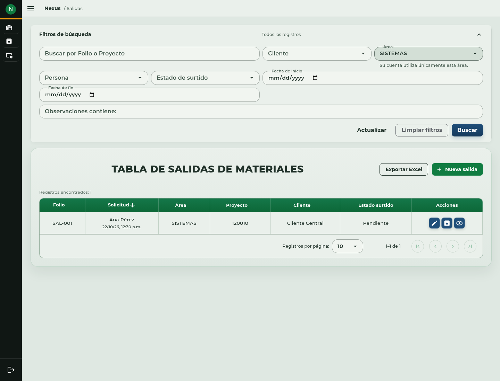
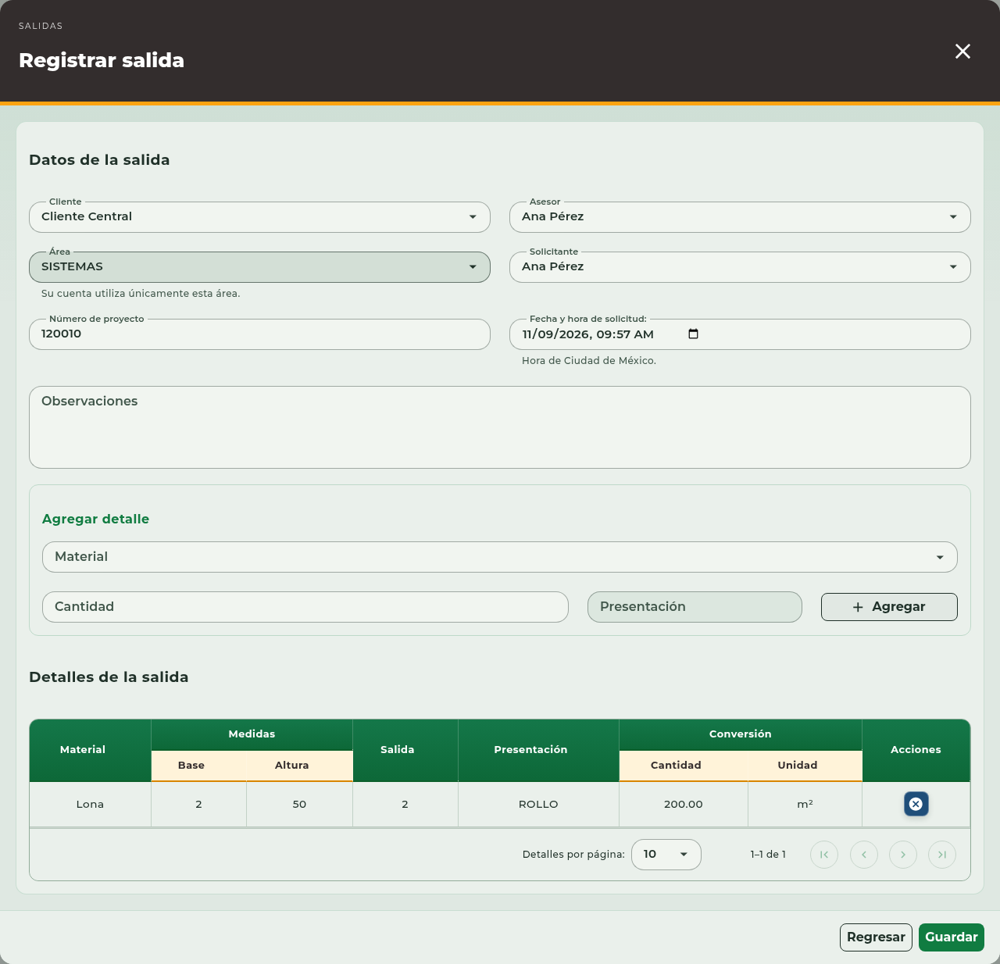
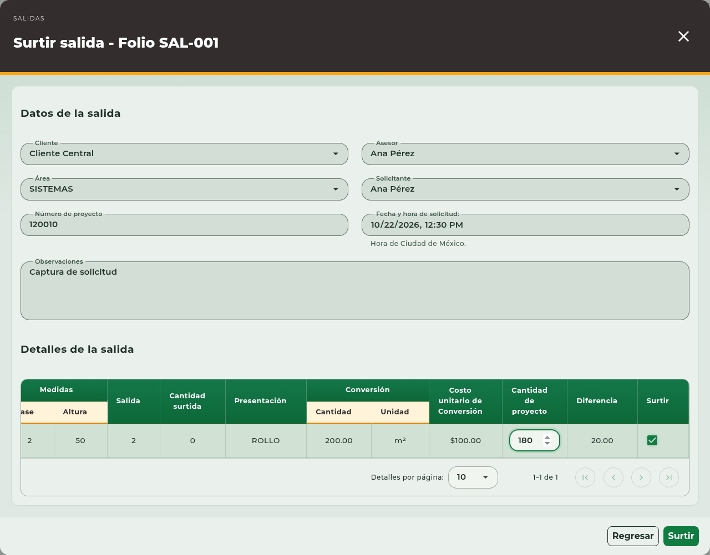
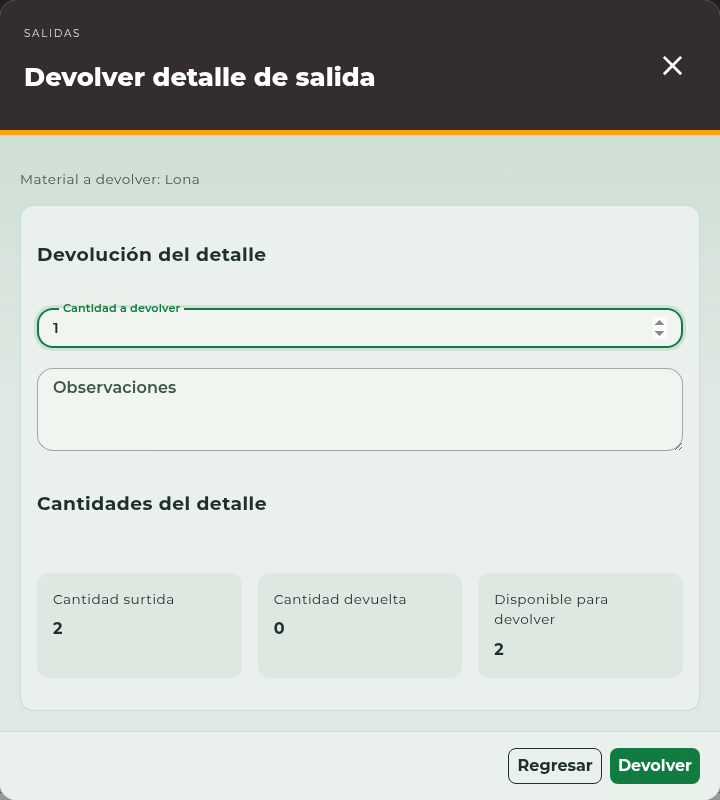

# 12. Salidas

<!-- module:any reference -->

Abra **Salidas → Materiales**, **Consumibles** o **Mermas**. Aplique búsqueda,
fechas, área o cumplimiento y pulse **Buscar**. Su cuenta sólo muestra las áreas autorizadas.

<!-- module:end -->

<!-- module:any salidas-materiales -->

Abra **Salidas → Materiales**. Aplique búsqueda, fechas, área o cumplimiento y pulse **Buscar**. Su cuenta sólo muestra las áreas autorizadas.

<!-- module:end -->

<!-- module:any salidas-consumibles -->

Abra **Salidas → Consumibles**. Aplique búsqueda, fechas, área o cumplimiento y pulse **Buscar**. Su cuenta sólo muestra las áreas autorizadas.

<!-- module:end -->

<!-- module:any salidas-mermas -->

Abra **Salidas → Mermas**. Aplique búsqueda, fechas, área o cumplimiento y pulse
**Buscar**. Su cuenta sólo muestra las áreas autorizadas. En las partidas,
identifique la merma por nombre y proveedor, y revise medidas, presentación,
cantidad solicitada y conversión. Los grupos **Surtido registrado**, **Captura de
surtido** y **Devolución** muestran las cantidades de cada operación cuando
corresponden.

<!-- module:end -->
Las cuentas operativas consultan las salidas de las áreas que tienen asignadas.
Su tabla omite la columna **Área**. Si dispone de una sola área, permanece
seleccionada al limpiar filtros.

<!-- module:any reference salidas-materiales -->

<!-- module:end -->

<!-- manual:any goods:issues-manage waste:issues-manage -->
## Registrar una solicitud

1. Pulse **Nueva salida** y seleccione cliente, asesor y solicitante. Si su cuenta
   tiene una sola área autorizada, aparecerá seleccionada y bloqueada. Si tiene
   varias asignaciones, elija el área de la solicitud.
2. Capture proyecto, fecha y observaciones. Para **GPG INTERNO**, conserve el proyecto del área.
3. En el último renglón de detalles, seleccione el artículo en su columna, capture **Cantidad** bajo **Salida** y pulse **Agregar**.
4. Revise las partidas, pulse **Guardar** y compruebe el folio y su estado.

<!-- module:any reference salidas-materiales -->

<!-- module:end -->

El nombre, las medidas, la presentación y la unidad corresponden al catálogo del artículo. El proveedor se muestra debajo del nombre en cada detalle, para distinguir las ofertas del mismo artículo. Repetir artículo y proveedor suma su cantidad; otro proveedor crea una partida distinta. En móvil se conserva esta identificación en las fichas.
Materiales y consumibles requieren al menos una unidad; merma admite cantidades positivas menores.
Al surtir, revise **Cantidad surtida** y **Pendiente de surtir** antes de capturar la nueva entrega. Al devolver, revise **Cantidad devuelta** y **Saldo entregado**.
Las solicitudes pendientes conservan las existencias.

<!-- manual:any goods:issue-details-manage waste:issues-supply -->
Almacén surte todas las partidas al guardar una nueva salida. Sistemas puede marcar
**Surtir al guardar** o dejar la solicitud pendiente. El surtido inmediato descuenta
existencias en la misma operación del alta. Si falta stock, el sistema revierte toda la operación.
<!-- manual:end -->

Seleccione un cliente y artículos con proveedor ya registrado. Si su cuenta pertenece
a un área operativa y falta un registro, solicite el alta al responsable de Almacén.
Salidas no ofrece alta de proveedores.

<!-- manual:all clients:create clients:read -->
### Registrar un cliente sin salir de la solicitud

1. Abra **Cliente** y **escriba el nombre completo del cliente nuevo en el selector**.
   Por ejemplo, escriba **Cliente nuevo**; el cliente todavía no tiene que estar registrado.
2. Espere a que termine la búsqueda. Si ya existe, seleccione el registro encontrado.
3. Si falta, pulse **Registrar cliente «Cliente nuevo»** al final de la lista o
   presione **Enter** en el selector. El botón aparece después de escribir el
   nombre, no al abrir el selector vacío.

4. Revise el **Nombre** precargado, mantenga **Activo** marcado y pulse **Guardar**.

5. Compruebe que regresa a la salida con el cliente seleccionado y continúe su captura.

Si no ve la acción, compruebe que el campo tenga texto, esté habilitado y la búsqueda
haya terminado sin error. Una coincidencia exacta o la falta de permiso también
impiden mostrar el botón. Crear el cliente no guarda la salida; si luego cierra
la solicitud, el cliente guardado permanece en el catálogo.
<!-- manual:end -->

## Editar

Pulse **Editar salida**, revise el estado y confirme los cambios con **Actualizar**.

| Situación | Campos habilitados | Datos que se conservan |
| --- | --- | --- |
| Pendiente, sin entregas | Cliente, Asesor, Área, Solicitante, Número de proyecto, Fecha y hora de solicitud y Observaciones; puede agregar o retirar partidas. | Folio; presentación, unidad y medidas de cada artículo. Los totales se calculan. |
| Surtido parcial o Surtido, sin cancelación | Cliente, Asesor, Área, Solicitante, Número de proyecto, Fecha y hora de solicitud y Observaciones, con las condiciones de selección indicadas abajo. | Partidas, cantidades solicitadas, surtidas y devueltas; esta edición no entrega ni devuelve inventario. |
| Cancelada | Ninguno: sólo consulta. | Encabezado y detalles históricos. |

Para corregir una cantidad mientras la salida sigue pendiente, retire la partida
y agréguela con la cantidad correcta. Revise las sumas si repite artículo y proveedor.
Después de una entrega no se modifican las partidas desde la edición.

Al editar desde un área operativa, el campo **Área** muestra el área original
de la salida y queda bloqueado. Almacén y Sistemas pueden cambiarla según sus
permisos. Para **GPG
INTERNO**, el sistema propone el proyecto del área; conserve ese valor, ya que
la validación exige que corresponda al área elegida. Cliente, área
y permisos delimitan los selectores de asesor y solicitante; revise esas selecciones
si cambia un dato del encabezado.
<!-- manual:end -->

## Consultar y distinguir estados

**Consultar salida** muestra estado, cantidades surtidas y devueltas, pendiente
de surtir y saldo entregado de cada partida. **Regresar** cierra sin cambios.

<!-- manual:any inventory:costs-read -->
En Sistemas y Almacén, **Costo máximo unitario** aparece después de **Conversión**.
**Importes** agrupa **Monto solicitado** y **Monto entregado neto**. Este último
descuenta las devoluciones. **Totales de salida** suma los importes de las partidas
activas. Los importes usan el costo guardado en cada partida al registrar la salida.
Las mermas antiguas pueden carecer de ese dato. El guion indica que el importe
no está disponible.
<!-- manual:end -->

| Cumplimiento | Qué significa |
| --- | --- |
| Pendiente | No hay entregas. |
| Surtido parcial | Se entregó una parte de un renglón o quedan renglones pendientes. |
| Surtido | Se completó la entrega. Una devolución parcial conserva este cumplimiento. |
| Cancelado | Todos los detalles se devolvieron por completo; sólo admite consulta. |

El estado se calcula al operar; abrir o cerrar una pantalla no lo cambia.
Las partidas canceladas se conservan sin botones de acción.

<!-- manual:any goods:issue-details-manage waste:issues-supply -->
## Surtir

En esta operación el encabezado y la solicitud original son de consulta. Se habilitan
la selección de partidas, **Cantidad a surtir** y **Cantidad de proyecto**.

1. Pulse **Surtir detalle** y marque las partidas que entregará.
2. Capture **Cantidad a surtir** sin superar el saldo pendiente.
3. Capture **Cantidad de proyecto**, que expresa el total del detalle para el proyecto.
4. Pulse **Surtir** y compruebe cantidades, cumplimiento y existencia descontada.

<!-- module:any reference salidas-materiales -->

<!-- module:end -->

El artículo debe tener costo máximo mayor que cero. Si falta, configúrelo en **Almacén**.
La cantidad de proyecto se expresa en la unidad de conversión y sirve para comparar
lo previsto con la cantidad convertida. El descuento de stock usa **Cantidad a surtir**. En **KILOGRAMOS** y **METRO LINEAL**, puede solicitar y surtir fracciones desde `0.01`: entregar `0.25` descuenta `0.25` del stock y de su cantidad convertida, porque sus medidas son `1 × 1`. Registrar la solicitud no descuenta existencias; cada entrega descuenta sólo lo efectivamente surtido.

## Devolver una entrega

Almacén y Sistemas pueden devolver partidas desde la consulta de la salida.

1. En una salida **Surtida**, pulse **Devolver detalle de salida** en la partida correspondiente.
   El listado también ofrece el acceso **Devolver material surtido** en esa salida.
2. Revise el folio, el artículo y el saldo disponible. Capture la cantidad recibida y las observaciones.
3. Pulse **Devolver**. El material se reintegra al inventario y la devolución queda vinculada a la partida original.

<!-- module:any reference salidas-materiales -->

<!-- module:end -->

Una devolución parcial conserva el detalle surtido. La devolución total lo cancela;
cuando todos se cancelan, se cancela la salida. No hay otra acción de cancelación.
Al confirmar, se cierra la devolución y vuelve a mostrarse la salida actualizada.
Puede devolver otro renglón con saldo; si la salida queda cancelada, sólo admite consulta.
No se devuelve mientras la salida siga en **Surtido parcial**.
<!-- manual:end -->

Materiales, Consumibles y Mermas comparten los estados de la tabla anterior.
Los ejemplos visuales siguientes se incluyen cuando existen documentos disponibles.

<!-- manual:any goods:issues-page-view -->
<!-- module:any reference salidas-materiales -->

<!-- module:end -->

<!-- module:any reference salidas-consumibles -->

<!-- module:end -->

<!-- module:any reference salidas-materiales -->

<!-- module:end -->

<!-- module:any reference salidas-consumibles -->

<!-- module:end -->

<!-- module:any reference salidas-materiales -->

<!-- module:end -->

<!-- module:any reference salidas-consumibles -->

<!-- module:end -->
<!-- manual:end -->

<!-- manual:any waste:issues-page-view -->
<!-- module:any reference salidas-mermas -->

<!-- module:end -->

<!-- module:any reference salidas-mermas -->

<!-- module:end -->

<!-- module:any reference salidas-mermas -->

<!-- module:end -->
<!-- manual:end -->

<!-- manual:any issues:reconcile -->
## Registrar entregas históricas ya realizadas

1. Pulse **Registrar entregas históricas** en Salidas de Materiales, Consumibles o Mermas.
   La fecha y hora de apertura del diálogo fijan el corte. La tabla muestra el rango y el total
   con 100 registros por página.
2. Seleccione sólo salidas entregadas por completo. Si ya verificó la página visible, marque
   la casilla del encabezado para agregarlas en el orden de la tabla hasta completar
   el lote. En móvil, la casilla aparece encima de las fichas. Al desmarcarla sólo se
   quitan las salidas de esa página. Para más de 100, confirme varios lotes por módulo.
3. Encima de la tabla, escriba el **Motivo de la regularización**. Si tiene un comprobante,
   incluya su referencia.
   Confirme la entrega física completa antes del corte y pulse
   **Registrar entregas seleccionadas**. Conserve el recibo de cada lote y vuelva a abrir el
   diálogo para cargar las salidas restantes.
4. Si Almacén sigue desactualizado, aplique el conteo físico como saldo final con una cuenta
   autorizada para ajustar existencias. En Excel, use **Ajustar existencias** y capture el
   **Stock contado**. Incluya los movimientos reales ocurridos entre el conteo y el ajuste.

<!-- manual:any goods:issues-page-view -->
<!-- module:any reference salidas-materiales -->

<!-- module:end -->
<!-- manual:end -->

<!-- manual:any goods:issues-page-view -->
<!-- module:any reference salidas-consumibles -->

<!-- module:end -->
<!-- manual:end -->

<!-- manual:any waste:issues-page-view -->
<!-- module:any reference salidas-mermas -->

<!-- module:end -->
<!-- manual:end -->

Completa sólo lo que faltaba registrar. Conserva devoluciones y no vuelve a descontar
stock ni genera movimientos. Consulta y Excel identifican la procedencia histórica.
La salida regularizada queda disponible para consulta. Con permiso de costos, la
consulta muestra el **Monto solicitado** a partir del costo guardado. El **Monto
entregado neto** queda **Sin verificar**, igual que el solicitado si falta el costo de
origen.
Si cambia un documento, vuelva a abrir el diálogo y revise los folios. Si la confirmación queda
pendiente, pulse **Revisar y reintentar registro** para retomar el mismo lote.

Una devolución posterior exige confirmar que el material está entrando físicamente
al almacén ahora. No registrar como devolución material que ya se incluyó en el conteo.
<!-- manual:end -->

<!-- manual:any warehouse:reports-read -->
## Exportar

Pulse **Exportar Excel**, elija alcance y confirme **Descargar Excel**.
Consulte [Reportes](14-reports.md).
<!-- manual:end -->
