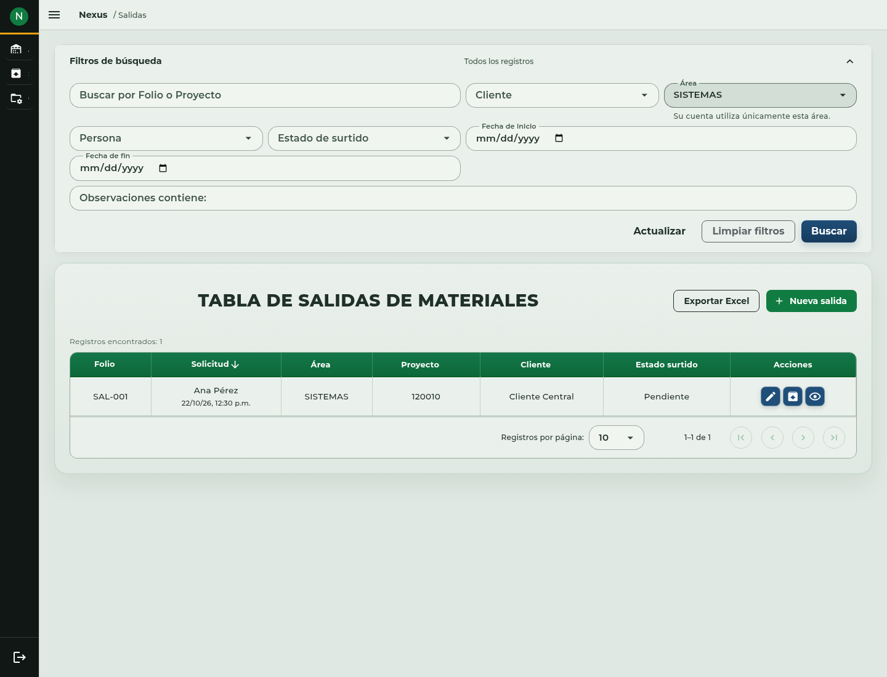
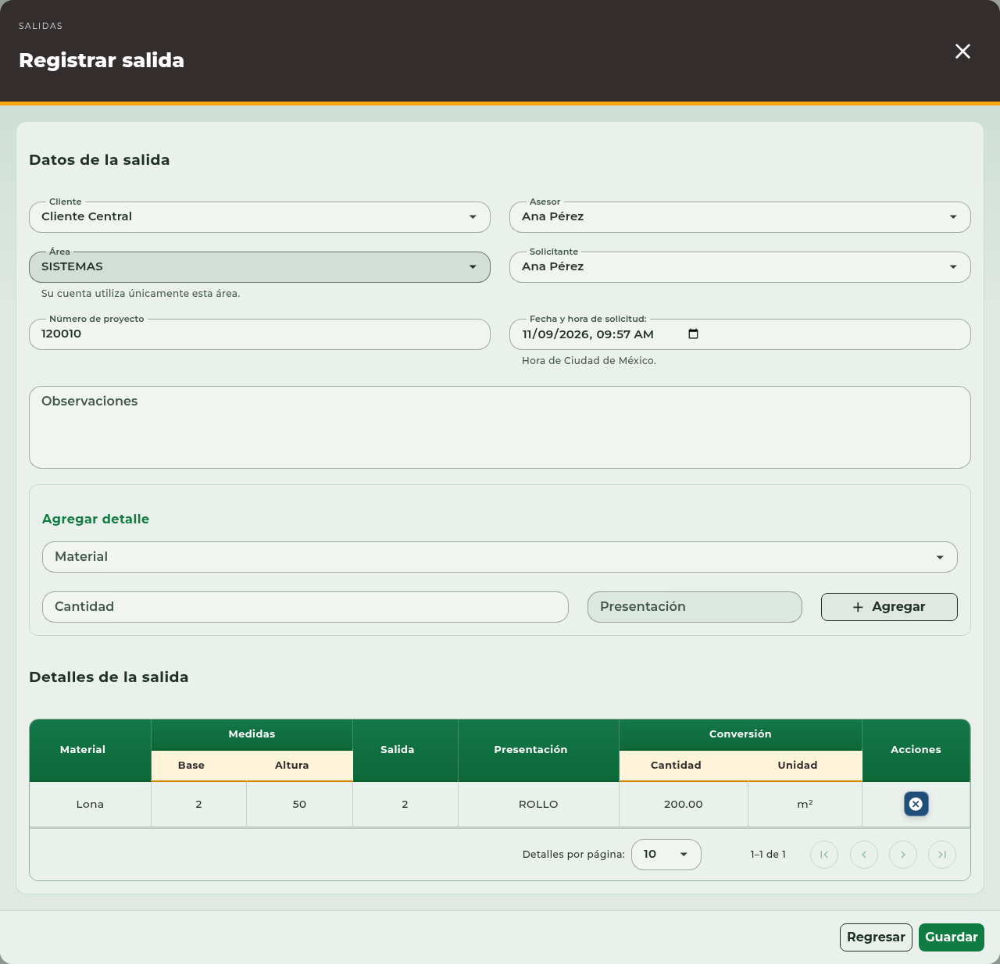
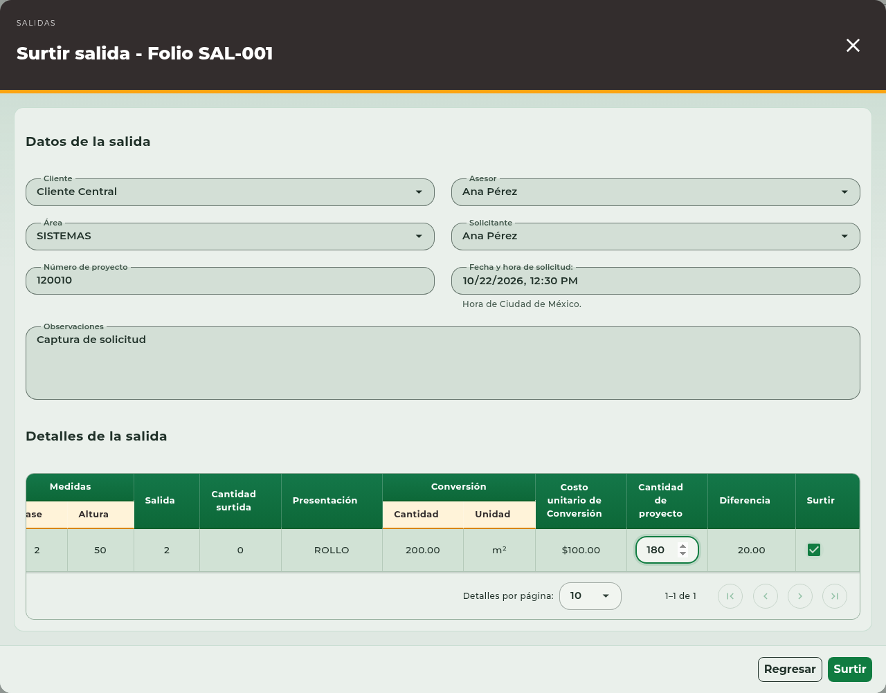
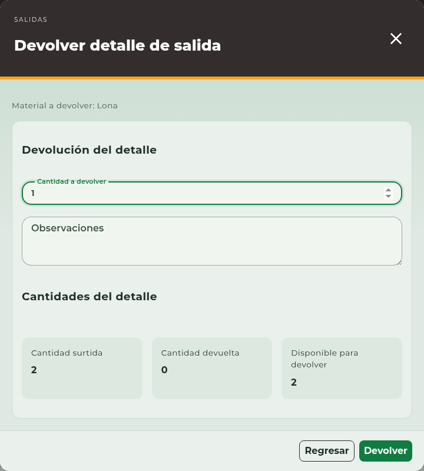

# 12. Salidas

<!-- module:any reference -->

Abra **Salidas → Materiales**, **Consumibles** o **Mermas**. Aplique búsqueda,
fechas, área o cumplimiento y pulse **Buscar**. Su cuenta sólo muestra las áreas autorizadas.

<!-- module:end -->

<!-- module:any salidas-materiales -->

Abra **Salidas → Materiales**. Aplique búsqueda, fechas, área o cumplimiento y pulse **Buscar**. Su cuenta sólo muestra las áreas autorizadas.

<!-- module:end -->

<!-- module:any salidas-consumibles -->

Abra **Salidas → Consumibles**. Aplique búsqueda, fechas, área o cumplimiento y pulse **Buscar**. Su cuenta sólo muestra las áreas autorizadas.

<!-- module:end -->

<!-- module:any salidas-mermas -->

Abra **Salidas → Mermas**. Aplique búsqueda, fechas, área o cumplimiento y pulse **Buscar**. Su cuenta sólo muestra las áreas autorizadas.

<!-- module:end -->
Si dispone de una sola área, permanece seleccionada al limpiar filtros.

<!-- module:any reference salidas-materiales -->

<!-- module:end -->

<!-- manual:any goods:issues-manage waste:issues-manage -->
## Registrar una solicitud

1. Pulse **Nueva salida** y seleccione cliente, asesor, área y solicitante.
2. Capture proyecto, fecha y observaciones. Para **GPG INTERNO**, conserve el proyecto del área.
3. Seleccione el artículo del módulo, capture **Cantidad** y pulse **Agregar**.
4. Revise las partidas, pulse **Guardar** y compruebe el folio pendiente.

<!-- module:any reference salidas-materiales -->

<!-- module:end -->

Repetir artículo y proveedor suma su cantidad; otro proveedor crea una partida distinta.
Materiales y consumibles requieren al menos una unidad; merma admite cantidades positivas menores.
Solicitar no descuenta inventario.

Seleccione un cliente y artículos con proveedor ya registrado. Si su cuenta pertenece
a un área operativa y falta un registro, solicite el alta al responsable de Almacén.
Salidas no ofrece alta de proveedores.

<!-- manual:all clients:create clients:read -->
### Registrar un cliente sin salir de la solicitud

1. Abra **Cliente** y **escriba el nombre completo del cliente nuevo en el selector**.
   Por ejemplo, escriba **Cliente nuevo**; el cliente todavía no tiene que estar registrado.
2. Espere a que termine la búsqueda. Si ya existe, seleccione el registro encontrado.
3. Si falta, pulse **Registrar cliente «Cliente nuevo»**, al final de la lista.
   Ese botón aparece después de escribir el nombre, no al abrir el selector vacío.
4. Revise el **Nombre** precargado, mantenga **Activo** marcado y pulse **Guardar**.
5. Compruebe que regresa a la salida con el cliente seleccionado y continúe su captura.

Si no ve la acción, compruebe que el campo tenga texto, esté habilitado y la búsqueda
haya terminado sin error. Una coincidencia exacta o la falta de permiso también
impiden mostrar el botón. Crear el cliente no guarda la salida; si luego cierra
la solicitud, el cliente guardado permanece en el catálogo.
<!-- manual:end -->

## Editar

Pulse **Editar salida**, revise el estado y confirme los cambios con **Actualizar**.

| Situación | Campos habilitados | Datos que se conservan |
| --- | --- | --- |
| Pendiente, sin entregas | Cliente, Asesor, Área, Solicitante, Número de proyecto, Fecha y hora de solicitud y Observaciones; puede agregar o retirar partidas. | Folio; presentación, unidad y medidas de cada artículo. Los totales se calculan. |
| Surtido parcial o Surtido, sin cancelación | Cliente, Asesor, Área, Solicitante, Número de proyecto, Fecha y hora de solicitud y Observaciones, con las condiciones de selección indicadas abajo. | Partidas, cantidades solicitadas, surtidas y devueltas; esta edición no entrega ni devuelve inventario. |
| Cancelada | Ninguno: sólo consulta. | Encabezado y detalles históricos. |

Para corregir una cantidad mientras la salida sigue pendiente, retire la partida
y agréguela con la cantidad correcta. Revise las sumas si repite artículo y proveedor.
Después de una entrega no se modifican las partidas desde la edición.

Si la cuenta sólo tiene un área disponible, se conserva seleccionada. Para **GPG
INTERNO**, el sistema propone el proyecto del área; conserve ese valor, ya que
la validación exige que corresponda al área elegida. Cliente, área
y permisos delimitan los selectores de asesor y solicitante; revise esas selecciones
si cambia un dato del encabezado.
<!-- manual:end -->

## Consultar y distinguir estados

**Consultar salida** muestra estado, cantidades surtidas y devueltas, pendiente
de surtir y saldo entregado de cada partida. **Regresar** cierra sin cambios.

| Cumplimiento | Qué significa |
| --- | --- |
| Pendiente | No hay entregas. |
| Surtido parcial | Se entregó una parte de un renglón o quedan renglones pendientes. |
| Surtido | Se completó la entrega. Una devolución parcial conserva este cumplimiento. |
| Cancelado | Todos los detalles se devolvieron por completo; sólo admite consulta. |

El estado se calcula al operar; abrir o cerrar una pantalla no lo cambia.
Las partidas canceladas se conservan sin botones de acción.

<!-- manual:any goods:issue-details-manage waste:issues-supply -->
## Surtir

En esta operación el encabezado y la solicitud original son de consulta. Se habilitan
la selección de partidas, **Cantidad a surtir** y **Cantidad de proyecto**.

1. Pulse **Surtir detalle** y marque las partidas que entregará.
2. Capture **Cantidad a surtir** sin superar el saldo pendiente.
3. Capture **Cantidad de proyecto**, que expresa el total del detalle para el proyecto.
4. Pulse **Surtir** y compruebe cantidades, cumplimiento y existencia descontada.

<!-- module:any reference salidas-materiales -->

<!-- module:end -->

El artículo debe tener costo máximo mayor que cero. Si falta, configúrelo en **Almacén**.
La cantidad de proyecto se expresa en la unidad de conversión y sirve para comparar
lo previsto con la cantidad convertida. El descuento de stock usa **Cantidad a surtir**.

## Devolver una entrega

La devolución sólo captura la cantidad a devolver y sus observaciones para la partida
seleccionada. No modifica cliente, proyecto, artículo ni la cantidad solicitada.

1. En una salida **Surtida**, pulse **Devolver material surtido**.
2. Elija **Devolver detalle de salida** y compruebe el saldo retornable.
3. Capture cantidad y observaciones, confirme **Devolver** y revise el reintegro.

<!-- module:any reference salidas-materiales -->

<!-- module:end -->

Una devolución parcial conserva el detalle surtido. La devolución total lo cancela;
cuando todos se cancelan, se cancela la salida. No hay otra acción de cancelación.
Al confirmar, se cierra la devolución y vuelve a mostrarse la salida actualizada.
Puede devolver otro renglón con saldo; si la salida queda cancelada, sólo admite consulta.
No se devuelve mientras la salida siga en **Surtido parcial**.
<!-- manual:end -->

Materiales, Consumibles y Mermas comparten los estados de la tabla anterior.
Los ejemplos visuales siguientes se incluyen cuando existen documentos disponibles.

<!-- manual:any goods:issues-page-view -->
<!-- module:any reference salidas-materiales -->

<!-- module:end -->

<!-- module:any reference salidas-consumibles -->

<!-- module:end -->

<!-- module:any reference salidas-materiales -->

<!-- module:end -->

<!-- module:any reference salidas-consumibles -->

<!-- module:end -->

<!-- module:any reference salidas-materiales -->

<!-- module:end -->

<!-- module:any reference salidas-consumibles -->

<!-- module:end -->
<!-- manual:end -->

<!-- manual:any waste:issues-page-view -->
<!-- module:any reference salidas-mermas -->

<!-- module:end -->

<!-- module:any reference salidas-mermas -->

<!-- module:end -->

<!-- module:any reference salidas-mermas -->

<!-- module:end -->
<!-- manual:end -->

<!-- manual:any issues:reconcile -->
## Registrar entregas históricas ya realizadas

1. Conciliar primero el inventario mediante un conteo físico actual en Almacén.
2. Pulsar **Registrar entregas históricas** en el inventario de salidas correspondiente.
3. La tabla carga automáticamente las salidas pendientes y parcialmente surtidas, usando
   la hora actual como corte; no se necesita capturar una fecha.
4. Revisar la tabla de salidas pendientes y parcialmente surtidas, con cantidades ya
   registradas/devueltas. La tabla usa el mismo diseño que los listados del sistema, con
   **100 registros por página**, rango visible y total de salidas elegibles. La última página
   puede contener menos registros. El contador de seleccionadas es independiente del total.
   **Seleccionar todo** carga y marca los resultados de todas las páginas; la selección se
   conserva al navegar. Use la casilla del encabezado para seleccionar o deseleccionar todo;
   también puede marcar filas individuales. Seleccione sólo documentos entregados completamente.
   Cada lote admite
   hasta 100 salidas; si hay más, seleccione manualmente hasta 100 por lote.
5. Capturar motivo/evidencia. No capturar una fecha real común: cada salida puede haberse
   entregado en un momento distinto; el sistema guarda la fecha de regularización.
6. Declarar que todas las partidas pendientes seleccionadas se entregaron antes del corte.
7. Pulsar **Registrar entregas seleccionadas** y conservar el recibo.

<!-- manual:any goods:issues-page-view -->
<!-- module:any reference salidas-materiales -->

<!-- module:end -->
<!-- manual:end -->

<!-- manual:any goods:issues-page-view -->
<!-- module:any reference salidas-consumibles -->

<!-- module:end -->
<!-- manual:end -->

<!-- manual:any waste:issues-page-view -->
<!-- module:any reference salidas-mermas -->

<!-- module:end -->
<!-- manual:end -->

Completa sólo lo que faltaba registrar. Conserva devoluciones y no vuelve a descontar
stock ni genera movimientos. Consulta y Excel identifican la procedencia histórica;
costos y datos de proyecto históricos quedan sin verificar.
Si cambia un documento, volver a buscar/revisar. Si se pierde la respuesta, reabrir
y pulsar **Revisar y reintentar registro**; conserva captura y clave originales.

Una devolución posterior exige confirmar que el material está entrando físicamente
al almacén ahora. No registrar como devolución material que ya se incluyó en el conteo.
<!-- manual:end -->

<!-- manual:any warehouse:reports-read -->
## Exportar

Pulse **Exportar Excel**, elija alcance y confirme **Descargar Excel**.
Consulte [Reportes](14-reports.md).
<!-- manual:end -->
