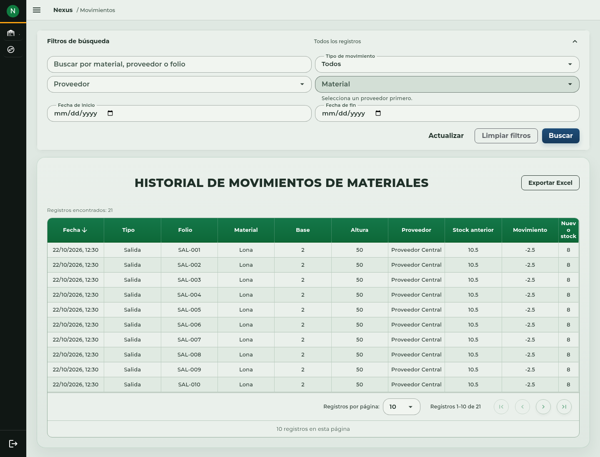

# 13. Movimientos

## Consultar el historial

Abra **Movimientos → Materiales**, **Consumibles** o **Mermas**. El historial
explica los cambios de existencia. Esta tabla es de consulta.

1. Abra el contexto que corresponde al artículo.
2. Si necesita un artículo concreto, seleccione primero **Proveedor** y después
   **Material**, **Consumible** o **Merma**.
3. Complete **Fecha de inicio**, **Fecha de fin**, tipo o texto de búsqueda cuando
   correspondan.
4. Abra **Filtrar por columna** para limitar por fecha, tipo, folio, artículo,
   medidas, proveedor o saldos; pulse **Aplicar filtros**.
5. Pulse **Buscar** y recorra los resultados. Ambos filtros se combinan y abarcan
   todas las páginas.
6. Ordene por los encabezados disponibles o use **Limpiar filtros** para regresar
   a la consulta general.

## Interpretar un movimiento

| Columna               | Interpretación                                                      |
| --------------------- | ------------------------------------------------------------------- |
| Fecha                 | Momento de la operación registrada.                                 |
| Tipo                  | Clasificación del movimiento.                                       |
| Folio                 | Referencia de la operación cuando existe.                           |
| Material o Consumible | Artículo afectado; en Mermas revise también la identidad y medidas. |
| Base y Altura         | Medidas disponibles del registro.                                   |
| Proveedor             | Proveedor del artículo.                                             |
| Stock anterior        | Existencia antes del movimiento.                                    |
| Movimiento            | Variación registrada; interprete su signo junto con el tipo.        |
| Nuevo stock           | Saldo resultante de esa operación.                                  |

Revise fecha, orden y artículo: puede haber movimientos posteriores al saldo
mostrado. Compare movimientos del mismo artículo y proveedor.

## Investigar una diferencia

1. Identifique el artículo y proveedor exactos en el inventario.
2. Filtre el historial de ese registro y el periodo relevante.
3. Localice el cambio por fecha, tipo y folio.
4. Consulte la compra o salida relacionada cuando corresponda.
5. Si necesita corregir, revise la operación de origen con su responsable.
   El historial no se modifica desde esta tabla.

<!-- manual:any admin:reports-read -->

Use **Exportar Excel** para descargar la consulta o un mes completo. Consulte [Reportes](14-reports.md).
<!-- manual:end -->

Ante un fallo, pulse **Reintentar**. Si no hay resultados, revise fechas y filtros.
