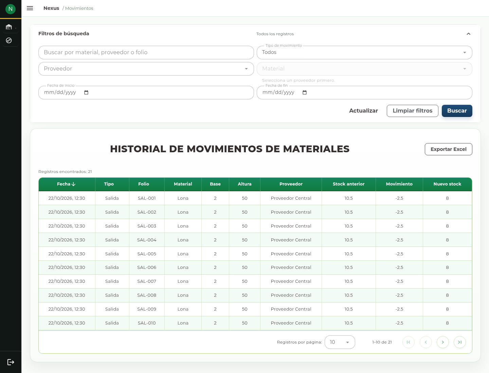

# 13. Movimientos

## Consultar el historial

Abra **Movimientos → Materiales**, **Consumibles** o **Mermas**. El historial
permite explicar cómo cambió la existencia. Es una consulta: no ofrece crear,
editar o borrar movimientos directamente.

1. Abra el contexto que corresponde al artículo.
2. Si necesita un artículo concreto, seleccione primero **Proveedor** y después
   **Material**, **Consumible** o **Merma**.
3. Complete **Fecha de inicio**, **Fecha de fin**, tipo o texto de búsqueda cuando
   correspondan.
4. Pulse **Buscar** y recorra los resultados.
5. Ordene por los encabezados disponibles o use **Limpiar filtros** para regresar
   a la consulta general.

## Interpretar una fila

| Columna | Interpretación |
| --- | --- |
| Fecha | Momento de la operación registrada. |
| Tipo | Clasificación del movimiento. |
| Folio | Referencia de la operación cuando existe. |
| Material o Consumible | Artículo afectado; en Mermas revise también la identidad y medidas. |
| Base y Altura | Medidas disponibles del registro. |
| Proveedor | Proveedor del artículo. |
| Stock anterior | Existencia antes del movimiento. |
| Movimiento | Variación registrada; interprete su signo junto con el tipo. |
| Nuevo stock | Saldo resultante de esa operación. |

Un saldo histórico no es necesariamente el saldo actual: pueden existir movimientos
posteriores. Para una revisión cronológica, compruebe fecha, orden y artículo.
Una búsqueda que agrupa artículos diferentes no debe interpretarse como la
secuencia de un único saldo.

## Investigar una diferencia

1. Identifique el artículo y proveedor exactos en el inventario.
2. Filtre el historial de ese registro y el periodo relevante.
3. Localice el cambio por fecha, tipo y folio.
4. Consulte la compra o salida relacionada cuando corresponda.
5. Si necesita corregir, utilice la operación autorizada de origen o un ajuste de
   conteo justificado. No intente corregir el historial desde esta tabla.

Con permiso de reporte, **Exportar Excel** permite descargar el periodo o consulta.
Un fallo de carga ofrece **Reintentar**. Si no hay resultados, revise el rango de
fechas y limpie filtros antes de reportar una pérdida de información.
