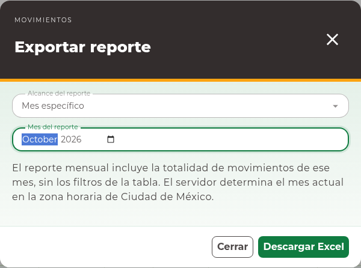

# 14. Reportes y descargas

## Identificar el alcance

Las descargas dependen del módulo y de los permisos de la cuenta. Inventario usa
**Descargar Excel**. Directorio e Identidad ofrecen **Exportar Excel**. Compras,
Salidas y Movimientos abren un diálogo **Exportar reporte** para seleccionar el
alcance.

Un reporte de consulta no se limita a las filas de la página visible. Compras,
Salidas, Movimientos, Identidad y Directorio utilizan los filtros admitidos de la
consulta. El texto que acaba de escribir en un
filtro no reemplaza la búsqueda aplicada: pulse **Buscar** antes de exportar.

## Descargar desde una tabla

1. Abra el módulo, capture los filtros y pulse **Buscar**.
2. Compruebe que la consulta representa lo que desea obtener.
3. Pulse **Descargar Excel** o **Exportar Excel**, según la página.
4. Espere la descarga y abra el archivo en una aplicación compatible con Excel.
5. Revise su contenido, periodo y artículos antes de distribuirlo.

En inventario, revise también **Incluir en Excel** antes de descargar:

| Opción | Registros incluidos por disponibilidad |
| --- | --- |
| Activos o con stock | Registros activos y registros que todavía tienen existencias. |
| Activos | Registros activos. |
| Con stock | Registros con existencias. |

Esta selección establece el alcance del archivo; no cambia los datos del inventario.
En Materiales y Consumibles, el Excel conserva la búsqueda por nombre e incluye
todos los proveedores del tipo elegido: el filtro por proveedor de la tabla no
limita ese archivo. En Mermas sí se utiliza también el proveedor seleccionado.

En Personas, el filtro por rol no es compatible con su exportación actual. Quite
ese filtro y vuelva a buscar; puede utilizar el filtro de área. La pantalla
deshabilita la exportación cuando se ha aplicado un rol.

## Elegir periodo o filtros en un documento

1. En Compras, Salidas o Movimientos, pulse **Exportar Excel**.
2. En **Exportar reporte**, revise **Alcance del reporte**.
3. Para la consulta de la tabla, seleccione **Filtros aplicados en la tabla**.
4. Para un periodo mensual, elija **Mes actual** o **Mes específico**. En el segundo
   caso capture **Mes del reporte** y compruebe año y mes.
5. Pulse **Descargar Excel** y espere el archivo.

El alcance mensual incluye todos los registros del mes y no aplica los filtros de
la tabla. **Mes actual** utiliza el mes determinado por el servicio en la zona
horaria de Ciudad de México. La consulta filtrada utiliza los filtros aplicados.
Revise la opción seleccionada cada vez; la página visible no define el contenido
del archivo.

## Resolver una descarga fallida

Si aparece **Error de descarga**, compruebe conexión y disponibilidad del servicio.
Corrija un mes inválido si el formulario lo señala y vuelva a descargar. Un
reintento de descarga no crea registros de inventario. Revise también si el
navegador bloqueó la descarga o cambió su carpeta de destino.

Si la acción no aparece, puede faltar el permiso de reporte. Solicite su revisión
al responsable de accesos. Los archivos descargados pueden contener información
operativa: compártalos sólo con las personas autorizadas por su organización.
