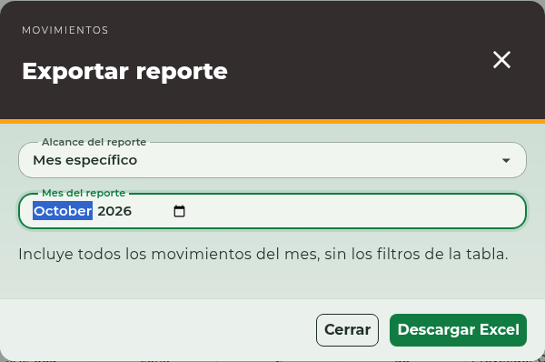

# 14. Reportes y descargas

## Descargar Excel

1. Abra el módulo, aplique los filtros y compruebe la consulta.
2. Pulse **Exportar Excel**.
3. Revise el alcance y confirme **Descargar Excel**.
4. Abra el archivo `.xlsx` y compruebe su contenido.

Los módulos con **Exportar Excel** usan este recorrido. El nombre incluye mes y año de descarga.
Cerrar el diálogo sin confirmar no genera un archivo.

<!-- module:any warehouse -->
<!-- manual:any warehouse:reports-read -->
## Inventario

En **Incluir en Excel**, seleccione **Activos o con stock**, **Activos** o **Con stock**.
Se conservan la búsqueda y el orden. Materiales y Consumibles incluyen todos los
proveedores del tipo seleccionado; Mermas conserva también el filtro de proveedor.
<!-- manual:end -->
<!-- module:end -->

<!-- module:any purchases issues movements -->
<!-- manual:any warehouse:reports-read admin:reports-read -->
<!-- manual:any warehouse:reports-read movements:read -->
## Compras, salidas y movimientos

En **Alcance del reporte**, elija:

| Opción | Contenido |
| --- | --- |
| Filtros aplicados en la tabla | Búsqueda, filtros y orden actuales, en todas las páginas. |
| Mes actual | Mes completo según el horario de Ciudad de México. |
| Mes específico | Mes completo del año y mes capturados. |

Los alcances mensuales omiten los filtros de la tabla.

<!-- module:any reference -->

En Compras y Salidas, el Excel separa los registros en hojas por mes y año, por
ejemplo **2026-01** y **2026-02**, en orden cronológico. Compras usa la fecha de
recepción; Salidas de materiales, consumibles y mermas usa la fecha de solicitud,
según el horario de Ciudad de México. Cada hoja de Compras calcula sus propios
totales y resúmenes, sin incluir registros de otros meses. Los filtros siguen
delimitando qué registros se exportan. Si no hay registros, se conserva una hoja
con los encabezados del reporte.

<!-- module:end -->

<!-- module:any compras-materiales compras-consumibles -->

El Excel separa las compras en hojas por mes y año (por ejemplo, **2026-01**),
según la fecha de recepción en Ciudad de México. Cada hoja calcula sus propios
totales y resúmenes. Los filtros delimitan qué registros se exportan.

<!-- module:end -->

<!-- module:any salidas-materiales salidas-consumibles salidas-mermas -->

El Excel separa las salidas en hojas por mes y año (por ejemplo, **2026-01**),
según la fecha de solicitud en Ciudad de México. Los filtros delimitan qué
registros se exportan. Sin registros se conserva una hoja con los encabezados.

<!-- module:end -->

<!-- module:any reference movements -->

<!-- module:end -->
<!-- manual:end -->
<!-- manual:end -->
<!-- module:end -->

<!-- module:any persons -->
<!-- manual:all persons:page-view person:reports-read -->
## Personas

En **Personas**, quite el filtro por rol para habilitar la descarga. Puede filtrar por área.
<!-- manual:end -->
<!-- module:end -->

## Si falla la descarga

Lea el aviso, revise la conexión y vuelva a pulsar **Descargar Excel**.
El diálogo conserva la selección. Descargar otra vez no modifica inventario.

## Distinguir el tipo de archivo

| Archivo | Uso |
| --- | --- |
| Reporte de **Exportar Excel** | Consultar o compartir los resultados y totales del alcance elegido. No modifica registros ni es una plantilla de importación. |
<!-- module:any import -->

| Archivo | Uso |
| --- | --- |
| Plantilla de **Importar Excel**, cuando tiene acceso | Preparar una operación sobre el inventario indicado; incluye las columnas de referencia y la captura necesaria. |
| Informe de **Descargar errores** | Localizar filas y columnas que debe corregir en el archivo de captura; no se importa como una plantilla. |

Los reportes de Compras, Salidas, Personas, Usuarios, Directorio y Movimientos no
permiten importar cambios desde esas pantallas. Conserve los originales y sus copias
según el [manejo de archivos en su equipo](02-navigation-and-controls.md#archivos-en-su-equipo).

<!-- module:end -->
